# Vocalab · AI Voice Studio local

[](https://github.com/minhnhatdepzai/voice-deeplearning/actions/workflows/ci.yml)
[](https://github.com/minhnhatdepzai/voice-deeplearning/pkgs/container/voice-deeplearning)
[](LICENSE)

Vocalab là ứng dụng React + FastAPI chạy cục bộ để tạo giọng tham chiếu từ audio/video/micro, fine-tune giọng bằng LoRA, chuyển lời nói thành văn bản (STT), tổng hợp giọng từ văn bản (TTS) và lồng tiếng vào media. Dự án ưu tiên `vi-VN` và `en-US`.

**Nói đúng về dự án:** hệ thống tích hợp model đã được huấn luyện sẵn và fine-tune **adapter VieNeu-TTS theo từng speaker**. Nó **không train model nền từ đầu**, **không có RAG**, và **không bảo đảm clone giống hệt mọi file đầu vào**. [Báo cáo số liệu](TRAINING_REPORT.md) · [Catalog checkpoint](models/catalog.json) · [Tải 15 adapter đã fine-tune](https://github.com/minhnhatdepzai/voice-deeplearning/releases/tag/v0.1.0-models).

**Bắt đầu cho người đóng góp:** [Cài bằng Docker và CI/CD](docs/DEPLOYMENT.md) · [Kiến trúc và chỗ cần sửa](docs/ARCHITECTURE.md) · [Hướng dẫn gửi pull request](CONTRIBUTING.md) · [Giấy phép MIT cho mã nguồn](LICENSE). Model, dữ liệu giọng và bản ghi không thuộc giấy phép mã nguồn.

## Đọc README theo vai trò

README đi từ bức tranh sản phẩm đến phần triển khai sâu. Người mới có thể đọc các mục đầu trước, sau đó quay lại
phần model và training.

| Bạn là ai? | Nên đọc theo thứ tự | Sau khi đọc cần trả lời được |
| --- | --- | --- |
| Người mới học full-stack | Chức năng → Kiến trúc → API → Lưu trữ → Docker | request đi đâu, file nằm ở đâu, worker chạy lúc nào |
| Frontend developer | Các trang → Speech to speech → API → trạng thái | browser thu âm, upload, poll job và phát kết quả thế nào |
| Backend developer | FastAPI → job bền vững → khóa GPU → media | validation, restart recovery và một worker hoạt động ra sao |
| AI/ML engineer | Model → speaker → LoRA → evaluation | model nào được train, dữ liệu nào được dùng, metric nào có ý nghĩa |
| DevOps/reviewer | Cài đặt → Docker → volume → CI/CD → vận hành | image chứa gì, dữ liệu nào tồn tại, kiểm thử và phát hành thế nào |

> **Mô hình tư duy cho người mới:** hãy xem Vocalab như một phòng thu. React là bàn điều khiển; FastAPI là kỹ
> thuật viên nhận yêu cầu; FFmpeg là bộ chuyển và phối định dạng; Whisper là người chép lời; VieNeu là người đọc;
> adapter LoRA là phần luyện thêm cho một chất giọng; `data/` là kho bản thu, job và model. Ví dụ này giúp hình dung
> luồng chính, còn quyền dữ liệu, GPU, lỗi model và chất lượng âm thanh vẫn do code cùng kiểm thử xử lý.

### Quy ước trạng thái trong tài liệu

- **Đã triển khai** nghĩa là có code trong repository.
- **Đã kiểm thử** nghĩa là có test tự động hoặc kết quả chạy được ghi rõ.
- **Đã đo cục bộ** chỉ đúng với máy, dữ liệu và cấu hình được nêu; không tự trở thành chỉ số production.
- **Tùy chọn** cần cài model hoặc môi trường riêng. **Chưa có** không được mô tả như tính năng đang chạy.
- Model nền, adapter và dataset là ba thứ khác nhau. Adapter LoRA cần model nền; dataset không nằm trong checkpoint.

## Mục lục

- [Gói ngữ cảnh đầy đủ dành cho AI](#gói-ngữ-cảnh-đầy-đủ-dành-cho-ai)
- [Kiến trúc và luồng xử lý](#kiến-trúc-và-luồng-xử-lý)
- [Luồng từng chức năng](#luồng-từng-chức-năng)
- [Frontend, backend và API](#frontend-backend-và-api)
- [Lưu dữ liệu như thế nào?](#lưu-dữ-liệu-như-thế-nào)
- [Cài đặt](#cài-đặt)
- [Model và vai trò](#model-và-vai-trò)
- [Fine-tuning: dữ liệu, thuật toán và kiểm chứng](#fine-tuning-dữ-liệu-thuật-toán-và-kiểm-chứng)
- [Đánh giá chất lượng đúng cách](#đánh-giá-chất-lượng-đúng-cách)
- [Docker và đóng gói](#docker-và-đóng-gói)
- [CI/CD và cách đóng góp](#cicd-và-cách-đóng-góp)
- [Vận hành và xử lý lỗi](#vận-hành-và-xử-lý-lỗi)
- [Cấu trúc mã nguồn](#cấu-trúc-mã-nguồn)
- [Thuật ngữ cần biết](#thuật-ngữ-cần-biết)
- [Phụ lục kiến thức chuyên sâu](#phụ-lục-kiến-thức-chuyên-sâu)

## Gói ngữ cảnh đầy đủ dành cho AI

Phần này là bản mô tả máy có thể đọc để một AI mở **một URL README trên GitHub** vẫn hiểu đủ hệ thống trước khi
đề xuất code. Nó mô tả code đang tồn tại tại commit chứa README, không thay thế việc đọc diff khi thực sự sửa file.

### Cách dùng link repository với AI

Có thể gửi AI câu lệnh ngắn sau:

```text
Đọc toàn bộ README của repository này trước: https://github.com/minhnhatdepzai/voice-deeplearning
Hãy coi mục “Gói ngữ cảnh đầy đủ dành cho AI” là source of truth về kiến trúc.
Phân biệt rõ: đã triển khai, đã kiểm thử, đã đo cục bộ, tùy chọn và chưa có.
Trước khi đề xuất sửa, nêu luồng hiện tại, file bị ảnh hưởng, data migration, test cần chạy và giới hạn GPU/audio.
Không giả định dự án có database, RAG, authentication, diarization tổng quát hoặc direct voice conversion.
Yêu cầu của tôi: <ghi yêu cầu ở đây>.
```

Nếu AI có thể mở thêm file GitHub, thứ tự nên đọc là `README.md` → `docs/ARCHITECTURE.md` → file trong bảng
“bản đồ thay đổi” → test tương ứng. Không cần tải raw audio, dataset, checkpoint hoặc `data/` để hiểu kiến trúc.

### Danh tính kỹ thuật của hệ thống

| Thuộc tính | Giá trị hiện tại |
| --- | --- |
| Tên sản phẩm | Vocalab · AI Voice Studio local |
| Kiểu ứng dụng | Single-user local web application |
| Frontend | React 19, React DOM 19, Vite 6, JavaScript JSX |
| Backend | Python 3.12 trong container, FastAPI, Uvicorn một worker |
| Xử lý media | FFmpeg/ffprobe; `rubberband` cho pitch/tempo khi có |
| STT | faster-whisper `small` hoặc `turbo` |
| TTS chính | VieNeu-TTS v3 Turbo; reference voice hoặc merged LoRA |
| TTS tùy chọn | VoxCPM2 cho clone tham chiếu |
| Tách audio | Demucs cho vocal/nhạc; ClearVoice cho hai speaker và denoise |
| Fine-tuning | LoRA theo từng speaker bằng recipe VieNeu upstream |
| Lưu trữ | Filesystem trong `data/`; JSON, JSONL, CSV, WAV và checkpoint |
| Job queue | `ThreadPoolExecutor(max_workers=1)` và trạng thái trên đĩa |
| GPU coordination | Cross-process `fcntl.flock` tại `data/auto_train/worker.lock` |
| Container | Multi-stage Node 22 + Python 3.12; NVIDIA runtime; named volume |
| CI | Python compile/test, shell syntax, Vite build, Compose config |
| CD | Tag `v*` build và push image lên GHCR |
| License code | MIT; không tự áp dụng cho dataset, checkpoint hoặc giọng nói |

Các phiên bản runtime khóa trong `requirements.lock` tại thời điểm viết gồm FastAPI 0.159.1, faster-whisper 1.2.1,
Pydantic 2.14.1, ONNX Runtime 1.23.2, NumPy 2.5.4, SciPy 1.18.1, SoundFile 0.14.0 và Uvicorn 0.54.0. Phạm vi khai
báo hỗ trợ nằm trong `requirements.txt`; lockfile mới là đầu vào tái tạo container/CI.

### Mười hai bất biến không được phá khi sửa code

1. `data/` chứa dữ liệu riêng tư và artifact lớn, không được commit vào Git hoặc bake vào public image.
2. Mỗi voice ID và job ID là UUID hex 32 ký tự; đường dẫn nhận ID phải validate trước khi nối filesystem.
3. Upload chỉ nhận phần mở rộng trong allowlist và mặc định tối đa 500 MB; file rỗng bị từ chối.
4. File thư viện hoặc training dài tối đa 3.600 giây; guided clip phải dài 3–15 giây.
5. Người dùng phải xác nhận quyền sử dụng giọng trước khi tạo voice, thêm training file hoặc tách giọng mục tiêu.
6. Một GPU lock dùng chung giữa training và inference nặng; không tạo đường chạy mới bỏ qua lock.
7. Speech jobs giữ input cho tới khi hoàn tất hoặc lỗi để có thể requeue sau API restart.
8. Docker/Uvicorn chạy một worker cho tới khi queue và lock chuyển sang dịch vụ dùng chung.
9. Adapter upload cũ không bị thay nếu dữ liệu thiếu, precheck xấu, train lỗi hoặc cold reload lỗi.
10. Dataset đã duyệt có hash; sửa transcript hoặc include flag phải làm mất hiệu lực precheck cũ.
11. Fine-tuned voice chỉ được nạp khi run có trạng thái `evaluated` hoặc `full_trained` và merged model tồn tại.
12. Health HTTP không được dùng làm bằng chứng inference hoặc chất lượng giọng; phải sinh và kiểm tra WAV thật.

### Những thứ không tồn tại trong code hiện tại

| Khái niệm dễ bị AI đoán nhầm | Sự thật trong repository |
| --- | --- |
| PostgreSQL, MongoDB hoặc SQLite | Không có; metadata nằm trên filesystem |
| Redis, Celery, Kafka hoặc RabbitMQ | Không có; queue nằm trong process |
| RAG hoặc vector database tài liệu | Không có; speaker embedding chỉ biểu diễn âm sắc |
| OAuth, JWT, session đăng nhập, RBAC | Không có; app chỉ nên bind localhost |
| Multi-tenant | Không có; file và voice không có owner account |
| Kubernetes hoặc Helm | Không có; deployment hiện dùng Docker Compose |
| Direct streaming voice conversion | Không có; speech-to-speech bắt đầu sau khi bấm dừng và chạy ASR→TTS |
| Diarization tổng quát N người | Không có; clustering chọn giọng và model separation tối đa hai stem |
| Emotion model/style token đã train | Không có; preset biểu cảm là hậu xử lý prosody |
| Training base model từ đầu | Không có; chỉ fine-tune LoRA VieNeu theo speaker |
| Production MOS/ABX | Chưa có; metric hiện tại chủ yếu là proxy và benchmark cục bộ |

### Tiến trình khởi động

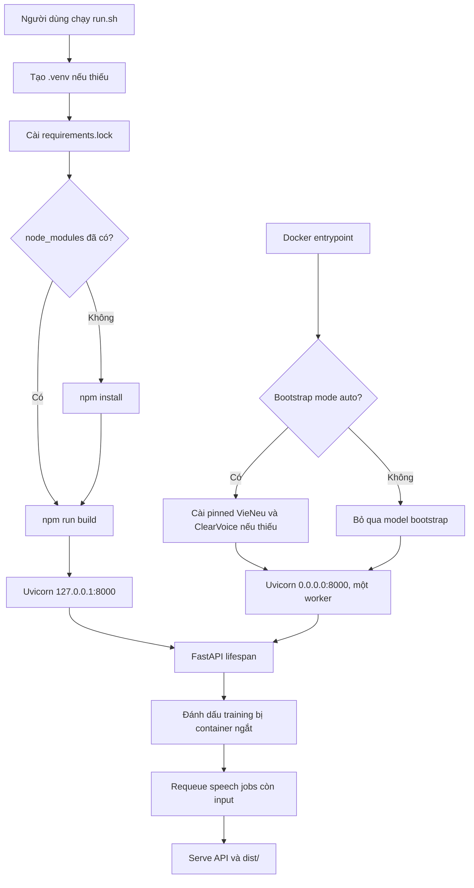

`run.sh` chỉ cài app dependency và build UI; môi trường training VieNeu/ClearVoice được cài bằng `training/setup.sh`
và `training/setup_voice_filter.sh`. Docker entrypoint có thể bootstrap hai môi trường đó trong volume ở lần đầu.

### Biến môi trường và cấu hình chạy

| Biến | Mặc định | Được đọc ở đâu | Tác dụng |
| --- | --- | --- | --- |
| `VOCALAB_PORT` | `8000` | `compose.yaml` | Port host, vẫn bind `127.0.0.1` |
| `VOICE_STUDIO_BOOTSTRAP_MODE` | `auto` | Docker entrypoint | `auto` cài upstream; `skip` chỉ bỏ bootstrap |
| `VOICE_STUDIO_DATA` | `<repo>/data` | `server/app.py` | Đổi root filesystem runtime |
| `VOICE_STUDIO_WORKER_MODE` | desktop systemd | API/Compose | `subprocess` trong container; desktop dùng `systemd-run --user` |
| `WHISPER_MODEL` | `small` | STT file thông thường | Override model STT ngoài profile tương tác |
| `VIENEU_UPSTREAM` | `data/upstream/vieneu` | train/API | Đổi checkout VieNeu upstream |
| `HF_HOME` | theo hệ thống; Compose `/app/data/huggingface` | Hugging Face | Đặt model cache trong volume |
| `NVIDIA_VISIBLE_DEVICES` | `all` trong image | NVIDIA runtime | GPU nhìn thấy trong container |
| `NVIDIA_DRIVER_CAPABILITIES` | `compute,utility` | NVIDIA runtime | Capability cần cho CUDA và `nvidia-smi` |

`VOICE_STUDIO_BOOTSTRAP_MODE=skip` không làm inference tự hoạt động. Nó chỉ giúp smoke test API khi upstream model
chưa được cài. Không đưa secret vào image hoặc commit `.env`.

### Hợp đồng API đầy đủ ở mức kiến trúc

Mọi route dùng prefix `/api`. JSON lỗi theo chuẩn FastAPI có trường `detail`. Route upload dùng
`multipart/form-data`; route có Pydantic model dùng JSON. File media chỉ được trả qua route kiểm soát, không mount
toàn bộ `data/` thành static directory.

#### Health và guided self-training

| Method và path | Input | Output hoặc hành vi chính |
| --- | --- | --- |
| `GET /health` | Không | `ok`, trạng thái TTS worker, STT warm/device và FFmpeg |
| `GET /self-training/sessions` | Không | Danh sách session mới nhất trước |
| `POST /self-training/sessions` | JSON `{name, locale, consent}` | Tạo session 80 prompts; `locale` là `vi-VN` hoặc `en-US` |
| `GET /self-training/sessions/{id}` | Session ID | State cùng `accepted_count`, `accepted_seconds`, `ready_to_train` |
| `POST /self-training/sessions/{id}/clips/{index}` | Form file | Decode 24 kHz, kiểm tra 3–15 giây, ASR và so với prompt |
| `POST /self-training/sessions/{id}/clips/{index}/accept` | Không | Người dùng xác nhận clip ASR chưa tự đạt |
| `GET /self-training/sessions/{id}/clips/{index}/audio` | Không | WAV clip đã thu |
| `POST /self-training/sessions/{id}/train` | Không | Prepare dataset và dispatch `training.self_train` |

Guided session cần tối thiểu 50 clip đã chấp nhận và 300 giây. Clip tự đạt khi có transcript và similarity chữ
không dấu từ `SequenceMatcher` ít nhất 0,65. WAV sau decode phải mono, PCM 16-bit, 24 kHz; RMS dưới 0,006 hoặc tỷ lệ
clipping trên 2% bị từ chối.

#### Corpus training và model registry

| Method và path | Input | Output hoặc hành vi chính |
| --- | --- | --- |
| `GET /training/sources` | Không | Nguồn, license, trainable và archive đã tải chưa |
| `GET /training/benchmarks` | Không | Benchmark FPT đã có trên đĩa |
| `GET /training/speakers/{source}` | Source ID | Speaker và số clip trong archive |
| `GET /training/datasets` | Không | Prepared manifests |
| `POST /training/prepare` | JSON `{source, speaker, max_clips}` | Job chuẩn bị dataset |
| `POST /training/train` | JSON `{dataset, steps}` | Job chạy LoRA |
| `GET /training/jobs` | Không | Job prepare/train/evaluate trong bộ nhớ process |
| `POST /training/evaluate` | JSON `{run, count}` | Sinh và chấm tối đa 30 test items |
| `POST /training/benchmark/fpt` | Không | Chạy STT benchmark FPT |
| `POST /training/register` | JSON `{run}` | Thêm run `evaluated` hoặc `full_trained` vào voice library |
| `GET /training/runs` | Không | Trạng thái, updates, hash, metrics và registration |
| `GET /training/queue` | Không | Trạng thái auto/extended training nếu có |

Validation JSON:

```json
{
  "prepare": {
    "source": "vivos",
    "speaker": "VIVOSSPK13",
    "max_clips": 300
  },
  "train": {
    "dataset": "vivos_VIVOSSPK13",
    "steps": 90
  },
  "evaluate": {
    "run": "my_vivos_spk13",
    "count": 20
  },
  "register": {
    "run": "my_vivos_spk13"
  }
}
```

`speaker` chỉ nhận chữ, số, `_`, `-`, tối đa 80 ký tự. `max_clips` nằm trong 30–10.000; `steps` trong 1–10.000;
`count` trong 1–30. Tên dataset/run được giới hạn bằng regex để tránh path traversal.

#### Voice library, separation và TTS

| Method và path | Form/query quan trọng | Output hoặc hành vi chính |
| --- | --- | --- |
| `GET /voices` | Không | Voice reference và fine-tuned voice trong `voices.json` |
| `POST /voices` | `file`, `name`, `start`, `consent`, `locale`, `speaker_mode` | Lưu nguồn và tạo reference WAV |
| `DELETE /voices/{id}` | query `purge_derived` | Xóa voice; tùy chọn xóa derivative hợp lệ |
| `POST /voices/{id}/training-files` | `file`, `consent` | Thêm bản thu cùng speaker; chặn file trùng hash |
| `GET /voices/{id}/training` | Không | Trạng thái upload worker và run stage nếu có |
| `POST /voices/{id}/refresh-reference` | query `clean` | Chọn/tạo lại mẫu tham chiếu |
| `POST /voices/{id}/train-full` | query `clean` | Dispatch upload training worker |
| `GET /voices/{id}/training-review` | `offset`, `limit` | Trang candidate clips; mặc định 25 |
| `GET /voices/{id}/training-review/{filename}` | Filename dạng `000001.wav` | Audio candidate để nghe |
| `PUT /voices/{id}/training-review/{filename}` | JSON `{text, include}` | Sửa transcript hoặc loại clip |
| `POST /voices/{id}/training-review/approve` | Không | Ghi train files/hash và tiếp tục worker |
| `GET /voices/{id}/source` | Không | Stream file nguồn với media type được phát hiện |
| `POST /separate` | `file` | Demucs vocal/accompaniment |
| `POST /target-voice` | `file`, `voice_id` hoặc `reference`, `mode`, `enhance`, `consent`, `auto_dominant`, `locale` | WAV mục tiêu, residual và MP4 nếu nguồn là video |
| `POST /tts` | `voice_id`, `text`, `delivery`, `video/source`, `source_mode`, `engine`, `locale` | WAV hoặc media đã phối |

`POST /voices` có hai cách chọn reference: `speaker_mode=manual` dùng điểm `start`; chế độ dominant phân tích vùng
lời rồi chọn cụm nhiều thời lượng nhất. `start` không có nghĩa pipeline fine-tune chỉ đọc từ vị trí đó. Text TTS
phải dài 1–5.000 ký tự.

#### Speech-to-speech, STT và editor

| Method và path | Input | Output hoặc hành vi chính |
| --- | --- | --- |
| `POST /speech-to-speech/warmup` | JSON `{voice_id, quality, language}` | Load STT/TTS và trả thời gian warmup |
| `POST /speech-to-speech/release` | Không | Dừng warm VieNeu subprocess |
| `POST /speech-to-speech` | Form file + các profile | Xử lý đồng bộ, chủ yếu dùng benchmark/compatibility |
| `POST /speech-to-speech/jobs` | Form file + các profile | Trả HTTP 202 và state job ngay |
| `GET /speech-to-speech/jobs/{id}` | Job ID | State, progress, result hoặc error |
| `DELETE /speech-to-speech/jobs/{id}` | Job đã xong/lỗi | Xóa status/input/output; job đang chạy trả 409 |
| `POST /stt` | `file`, `language=auto|vi|en` | Transcript, segments và SRT/TXT URL |
| `GET /media/{kind}/{filename}` | Kind/filename allowlisted | Stream output đã tạo |
| `POST /editor/export` | `files[]`, JSON `timeline`, optional `overlay` | Render WAV nếu chỉ audio, MP4 nếu có video |

Speech profile là enum đóng, không nhận giá trị tùy ý:

| Nhóm | Tên | Tham số thật |
| --- | --- | --- |
| ASR | `fast` | Whisper `small`, beam 1 |
| ASR | `balanced` | Whisper `turbo`, beam 3 |
| ASR | `accurate` | Whisper `turbo`, beam 5 |
| TTS | `natural` | temperature 0,8; top-k 25; top-p 0,95; repetition penalty 1,2 |
| TTS | `clear` | temperature 0,55; top-k 20; top-p 0,9; repetition penalty 1,2 |
| TTS | `stable` | temperature 0,35; top-k 15; top-p 0,85; repetition penalty 1,2 |
| Output filter | `off` | Không thêm filter |
| Output filter | `light` | high-pass 55 Hz + `afftdn` nhẹ |
| Output filter | `strong` | high-pass 70 Hz + `afftdn` mạnh hơn |

Ví dụ tạo và poll speech job:

```bash
curl -sS -X POST http://127.0.0.1:8000/api/speech-to-speech/jobs \
  -F 'file=@recording.webm' \
  -F 'voice_id=0123456789abcdef0123456789abcdef' \
  -F 'language=vi' \
  -F 'quality=balanced' \
  -F 'tts_profile=stable' \
  -F 'denoise=light'

curl -sS http://127.0.0.1:8000/api/speech-to-speech/jobs/JOB_ID
```

Khi hoàn tất, `result` có transcript, ngôn ngữ phát hiện, voice ID/name, `audio_url`, thời lượng input, model/device
STT, số TTS chunks, warm flags và latency tách theo decode/STT/TTS/total.

### State machine: speech job

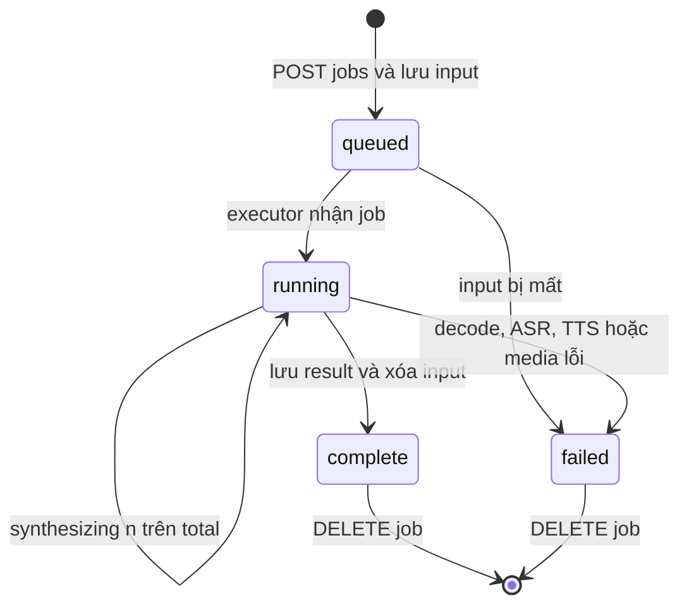

State mẫu, các timestamp dùng UTC ISO-8601:

```json
{
  "id": "32-hex-characters",
  "status": "running",
  "stage": "synthesizing",
  "voice_id": "32-hex-characters",
  "language": "vi",
  "quality": "balanced",
  "tts_profile": "stable",
  "denoise": "light",
  "filename": "recording.webm",
  "chunks_done": 2,
  "chunks_total": 4,
  "created_at": "UTC ISO-8601",
  "updated_at": "UTC ISO-8601"
}
```

### State machine: uploaded voice training

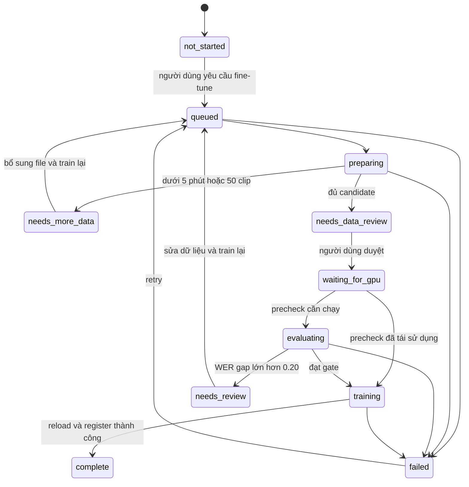

Container restart chuyển các trạng thái đang hoạt động `queued`, `preparing`, `waiting_for_gpu`, `training`,
`evaluating` thành `failed/interrupted`. Speech job có thể resume; optimizer training hiện không resume checkpoint.

### State machine: guided recording

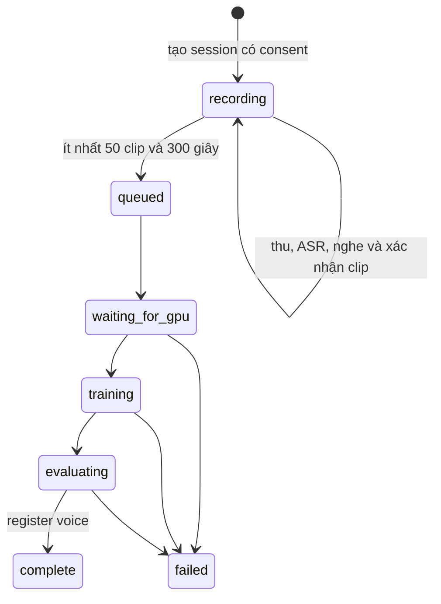

Guided dataset chia deterministically bằng SHA-256 của session ID và filename. Ít nhất 5 câu được đưa vào validation
và 5 câu vào test; các file trùng SHA-256 hoặc bị thay sau review bị từ chối.

### Schema dữ liệu quan trọng

Các JSON dưới đây là **schema minh họa**, không phải file chứa dữ liệu người dùng thật.

#### Voice index

```json
[
  {
    "id": "32-hex-characters",
    "name": "Tên hiển thị",
    "locale": "vi-VN",
    "kind": "reference hoặc finetuned",
    "duration": 420.5,
    "source": "tên nguồn hoặc corpus",
    "source_file": "file nguồn cục bộ",
    "run": "chỉ có khi kind là finetuned"
  }
]
```

Field có thể khác theo cách voice được tạo; code gọi phải dùng `.get()` cho metadata tùy chọn. Source media và
reference WAV nằm trong `data/voices/`; training files bổ sung nằm trong `data/voices/training/`.

#### Prepared dataset row và manifest

```json
{
  "file_name": "000123.wav",
  "text": "Câu đã chuẩn hóa và duyệt.",
  "speaker_id": "VIVOSSPK13",
  "language": "vi",
  "source": "vivos",
  "source_sha256": "sha256",
  "duration": 6.42,
  "split": "train"
}
```

```json
{
  "source": {
    "name": "Dataset name",
    "language": "vi",
    "license": "License text"
  },
  "source_id": "vivos",
  "speaker_id": "VIVOSSPK13",
  "locale": "vi-VN",
  "counts": {"train": 240, "validation": 30, "test": 30},
  "minutes": {"train": 14.1, "validation": 1.8, "test": 1.7},
  "preparation": "Mô tả cách chuẩn bị"
}
```

Corpus chuẩn có `train.jsonl`, `validation.jsonl`, `test.jsonl`, `train_metadata.csv`, `manifest.json` và
`raw_audio/`. Upload cuối có thể dùng `full_training=true`, mọi clip duyệt thuộc train và evaluation pre-final nằm
ở run riêng. Không được tự suy rằng mọi manifest đều có đủ ba split.

#### Training run status

```json
{
  "run": "run_name",
  "dataset": "/absolute/path/to/prepared",
  "source": "vivos",
  "speaker_id": "VIVOSSPK13",
  "status": "trained_pending_evaluation",
  "max_steps": 90,
  "optimizer_updates": 90,
  "config": {
    "batch_size": 2,
    "grad_accum": 2,
    "rank": 16,
    "target": "backbone",
    "lr": 0.0002
  },
  "upstream_commit": "git-sha",
  "adapter": "/path/to/adapter_model.safetensors",
  "adapter_sha256": "sha256",
  "merged": "/path/to/merged",
  "merged_sha256": "sha256",
  "preset_sha256": "sha256",
  "adapter_reload_verified": true,
  "peak_gpu_mib": 12345,
  "started_at": "UTC ISO-8601",
  "finished_at": "UTC ISO-8601"
}
```

Sau evaluation, state thêm `status=evaluated`, `evaluation`, `test_items`, `generated_wer`, `reference_wer` và có
thể có `speaker_similarity`. Upload model cuối dùng `status=full_trained` trước khi register.

#### Review state

```json
{
  "approved": false,
  "changes": {
    "000123.wav": {"text": "Transcript đã sửa", "include": true},
    "000124.wav": {"text": "Transcript cũ", "include": false}
  }
}
```

`review_candidates.jsonl` giữ candidate ban đầu. Khi approve, code tạo lại `train.jsonl` và
`train_metadata.csv` qua file tạm, cập nhật counts/minutes và lưu `review_sha256`.

### Thuật toán chính dưới dạng pseudocode

#### Chọn speaker nói nhiều nhất

```text
decode media thành audio chuẩn
segments = Whisper(audio, word_timestamps=true, VAD=true)
với mỗi vùng lời đủ điều kiện:
    embedding = frozen_speaker_encoder(wav_segment)
gom embedding gần nhau bằng cosine threshold
gộp các center gần như cùng giọng
duration_per_cluster = tổng thời lượng segment trong cluster
dominant_cluster = argmax(duration_per_cluster)
chọn segment sạch và gần center để làm reference
trả cluster, tỷ lệ thời lượng, timestamps và mức tin cậy
```

Đầu ra phụ thuộc vùng Whisper tìm thấy. “Nói nhiều nhất” nghĩa là tổng thời lượng trong các segment nhận diện được,
không phải toàn bộ thời gian file và không phải nhận diện danh tính.

#### Lọc giọng mục tiêu

```text
reference_embedding = encoder(reference 3-8 giây)
stem_a, stem_b = MossFormer2(mixture_16k)
score_a = cosine(encoder(stem_a speech regions), reference_embedding)
score_b = cosine(encoder(stem_b speech regions), reference_embedding)
nếu score cao nhất và margin đạt rule:
    target = stem có score cao hơn
    residual = mixture - target estimate
ngược lại:
    từ chối hoặc giữ đoạn không chắc chắn ở residual
nếu enhance=true:
    target = FRCRN(target)
đưa target và residual về timeline nguồn
mux lại video nếu đầu vào có hình
```

Rule còn dùng mixture/reference và margin để tránh chọn stem bị separation làm đổi màu giọng. Không được đơn giản
hóa thành “stem có cosine lớn nhất luôn đúng”. Regression test nằm ở `tests/test_target_voice.py`.

#### Speech-to-speech

```text
validate enum, voice_id, extension và kích thước
lưu input vào thư mục job trước khi enqueue
decode bằng FFmpeg thành mono 16 kHz
áp high-pass 70 Hz và low-pass 7.6 kHz
transcript = faster-whisper(profile.model, profile.beam, VAD)
locale = language yêu cầu hoặc ngôn ngữ phát hiện
chặn voice locale không khớp vi/en
normalized_text = normalize_for_speech(transcript, locale)
chunks = split theo dấu câu, tối đa 240 ký tự và không bỏ từ
giữ _tts_lock và GPU file lock
với từng chunk:
    warm_worker.synthesize(chunk, voice_config, sampling_profile)
concat PCM WAV bằng FFmpeg
áp filter off, light hoặc strong
lưu result và latency rồi xóa input tạm
```

Warm worker là subprocess giao tiếp qua JSON lines. Nó chỉ reload model khi config model/voice thay đổi; reference
mode vẫn truyền reference WAV. TTS chunks được ghép tuần tự, không giữ timing gốc của input.

#### Upload-to-LoRA

```text
snapshot voices.json và training files của voice
decode mỗi nguồn; nếu clean=true thì lọc đúng target speaker
Whisper từng cửa sổ dài và ghép word timestamp qua biên
cắt clip 3-15 giây, loại trùng và clip không hợp lệ
chọn hoặc cập nhật reference tốt nhất
nếu usable < 300 giây hoặc clips < 50: needs_more_data rồi dừng
nếu chưa được review: needs_data_review rồi dừng
lấy GPU file lock
nếu đủ dữ liệu và chưa có precheck hợp lệ:
    tạo dataset có test tách riêng
    train candidate 100 steps
    evaluate held-out sentences
nếu generated_WER - reference_WER > 0.20 và test_items >= 5:
    needs_review và giữ adapter cũ
thử full-data LoRA với batch 14, 12, 10, 8 khi đúng lỗi CUDA OOM
xác minh optimizer update, artifact, enrollment và cold reload hash
register voice mới
ghi complete; không thay giọng cũ khi bất kỳ gate nào lỗi
```

#### WER/CER evaluation

```text
verify adapter SHA-256 chưa thay sau training
sinh WAV cho câu test bằng merged model
Whisper beam 5 đọc reference_wav và generated_wav
normalize Unicode NFC, casefold, bỏ punctuation và gom whitespace
WER = Levenshtein(words_target, words_prediction) / số từ target
CER = Levenshtein(chars_target, chars_prediction) / số ký tự target
lưu từng item và tổng metric vào evaluation/results.json
```

WER của generated WAV chứa cả lỗi TTS lẫn lỗi Whisper. So với WER reference trên cùng câu giúp nhìn baseline ASR,
nhưng hiệu số vẫn không phải phép đo tự nhiên hoặc speaker identity.

### Concurrency, khóa và vòng đời tài nguyên

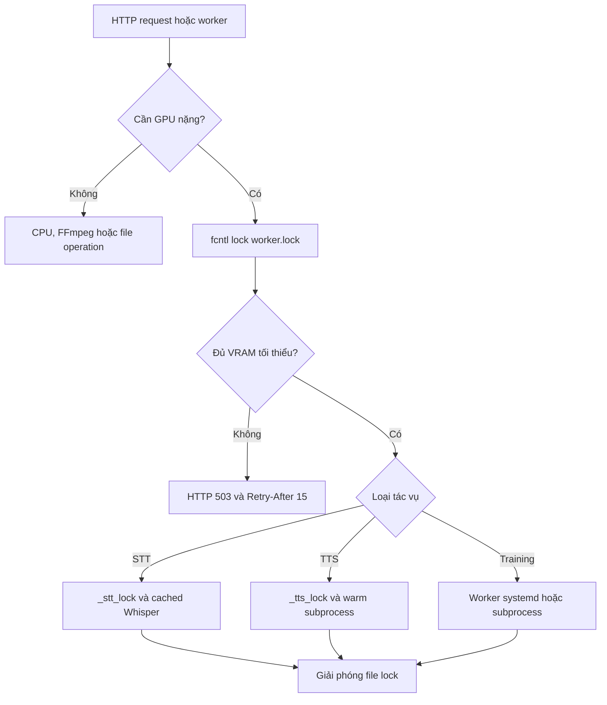

- `_voice_lock` bảo vệ đọc/ghi `voices.json` trong process.
- `_stt_lock` tránh nhiều thread dùng hoặc đổi cached Whisper cùng lúc.
- `_tts_lock` tuần tự hóa warm VieNeu worker.
- GPU file lock phối hợp API và process training trên cùng filesystem.
- Training pool và speech pool đều `max_workers=1`; đây là backpressure cục bộ, không phải distributed scheduler.
- API đợi GPU 30–300 giây tùy luồng rồi trả 503 có `Retry-After: 15`.
- Một số path đặt ngưỡng VRAM trống khoảng 2.500–4.500 MiB. Đây là admission threshold, không phải tổng VRAM model.

### Mã lỗi quan trọng

| HTTP | Trường hợp điển hình | Client nên làm gì |
| --- | --- | --- |
| 400 | Chưa xác nhận consent | Yêu cầu người dùng xác nhận quyền sử dụng |
| 404 | Voice, job, session, source hoặc media không tồn tại | Refresh state; không retry mù |
| 408 | FFmpeg/media process quá timeout | Giảm file hoặc kiểm tra codec/hardware |
| 409 | Xóa job đang chạy, session đã queue | Poll trạng thái hiện tại |
| 413 | File vượt 500 MB hoặc guided clip vượt 25 MB | Nén hoặc chia nguồn trong giới hạn chức năng |
| 415 | Extension không thuộc allowlist | Chuyển sang WAV/MP3/M4A/AAC/FLAC/OGG/Opus/WebM/MP4/MOV/MKV |
| 422 | Schema, locale, profile, media hoặc transcript không hợp lệ | Hiển thị `detail`, sửa dữ liệu rồi gửi lại |
| 503 | GPU lock bận hoặc VRAM thấp | Tôn trọng `Retry-After`, tránh retry storm |
| 507 | Ổ đĩa dưới ngưỡng an toàn | Dọn cache/output hoặc tăng volume |

### Bản đồ thay đổi dành cho AI

| Yêu cầu | File phải đọc đầu tiên | File liên quan | Test hoặc gate tối thiểu |
| --- | --- | --- | --- |
| Đổi navigation/Studio | `src/main.jsx` | `src/style.css` | `npm run build`, thao tác browser |
| Đổi recording/job UX | `src/SpeechToSpeech.jsx` | `server/app.py`, `server/speech_jobs.py` | `test_speech_jobs.py`, mic thật |
| Đổi ASR profile | `server/speech_to_speech.py` | benchmark interactive STT | cùng held-out set và latency |
| Giảm vấp text dài | `split_synthesis_text` | text normalization, warm worker | unit test không mất từ + bài nghe |
| Đổi TTS sampling | `server/speech_to_speech.py` | benchmark speech-to-speech | WER, cosine, latency và nghe mù |
| Đổi speaker clustering | `server/dominant_speaker.py` | benchmark interview | `test_dominant_speaker.py` |
| Đổi keep/remove speaker | `server/target_voice.py` | `training/separate_speakers.py` | `test_target_voice.py`, residual thật |
| Đổi segmentation | `training/uploaded_audio.py` | `training/upload_train.py` | boundary words và coverage test |
| Đổi human review | `training/dataset_review.py` | `src/TrainingReview.jsx` | review hash và empty dataset test |
| Đổi minimum data/gate | `training/upload_train.py` | library UI | precheck test, không thay adapter cũ |
| Đổi LoRA/artifact | `training/run.py` | VieNeu upstream | optimizer, cold reload, held-out eval |
| Đổi guided recording | `training/self_recording.py` | self train và UI | quality, split, consent, mic thật |
| Đổi editor | `server/timeline.py` | media edit và `src/Editor.jsx` | duration, sync, codec, file thật |
| Đổi persistence schema | module ghi JSON tương ứng | recovery và UI reader | migration fixture + restart test |
| Thêm nhiều API replicas | `server/speech_jobs.py` | mọi lock/pool/file writer | cần queue/DB/object store trước |
| Đổi Docker/CUDA | `Dockerfile`, `compose.yaml` | setup scripts, constraints | smoke + GPU inference/reload |
| Đổi dependency | `requirements.txt` | lockfile và CI | regenerate lock, pytest, build |

### Checklist AI phải trả lời trước thay đổi lớn

1. Luồng hiện tại từ UI đến output là gì?
2. Thay đổi thuộc frontend, API, worker, model, media hay storage?
3. Endpoint, schema hoặc state nào đổi; client cũ còn tương thích không?
4. Có làm mất restart recovery hoặc thay adapter cũ khi candidate lỗi không?
5. Có bỏ qua consent, file validation, path validation hoặc GPU lock không?
6. Có migration cho JSON/file đã tồn tại và Docker volume không?
7. Test CPU nào chứng minh contract; test GPU/audio nào chứng minh chất lượng?
8. Metric nào đo đúng yêu cầu và metric nào chỉ là proxy?
9. Artifact nào commit, artifact nào ở release, artifact nào phải private?
10. Cách rollback code, image, schema và adapter là gì?

## Kiến trúc và luồng xử lý

```mermaid
flowchart LR
  UI[React] --> API[FastAPI]
  API --> FF[FFmpeg: giải mã và ghép media]
  API --> STT[faster-whisper: STT và transcript]
  API --> DEM[Demucs: vocal / nhạc nền]
  API --> SEP[ClearVoice: hai stem và giảm nhiễu]
  API --> TTS[VieNeu-TTS: TTS / LoRA]
  API --> VOX[VoxCPM2: TTS tham chiếu tùy chọn]
  STT --> DATA[Clip + transcript + speaker]
  DATA --> LORA[LoRA từng speaker]
  LORA --> TTS
  FF --> OUT[WAV / MP4 / SRT]
  TTS --> OUT
  DEM --> OUT
  SEP --> OUT
```

| Trang | Việc người dùng làm | Xử lý thực tế |
| --- | --- | --- |
| Thư viện giọng | Tải MP3/MP4/WAV tối đa 60 phút, ghi micro, nghe/xóa file, fine-tune | Có thể tự tìm cụm giọng nói nhiều nhất; giữ file gốc đầy đủ; nghe/sửa/bỏ clip Whisper trước khi train |
| Studio | Chọn giọng và locale, viết thoại, điều chỉnh nhịp/giọng, chèn vào media | VieNeu/VoxCPM2 tạo WAV; FFmpeg chỉnh và xuất WAV/MP4 |
| Speech to speech | Thu liên tục, bấm **Dừng & nghe**, rồi nghe toàn đoạn bằng giọng đã train | MediaRecorder Opus → job lưu trên đĩa → Whisper turbo → chia text dài → VieNeu worker giữ nóng → ghép/lọc WAV; tải lại trang vẫn xem được tiến độ |
| Chuyển lời nói | Tải audio/video, lấy TXT/SRT | faster-whisper nhận dạng và gắn mốc thời gian |
| Tách theo người | Tự tìm người nói nhiều nhất hoặc chọn giọng mẫu, rồi giữ/bỏ người đó | Whisper tìm lời, encoder phân cụm/chọn người; MossFormer2 tách hai stem; FRCRN giảm nhiễu; xuất WAV/MP4 |
| Tự luyện giọng | Đọc câu gợi ý vào micro, xác nhận bản ghi | Chuẩn hóa/kiểm tra clip, chia tập và xếp hàng LoRA |
| Huấn luyện AI | Chọn dataset/speaker, prepare, train, evaluate, register | Gọi recipe LoRA VieNeu và đánh giá |
| Chỉnh sửa media | Cắt/tách/đổi thứ tự clip, tắt âm gốc, chèn WAV AI | Timeline cơ bản + FFmpeg, chưa có đầy đủ hiệu ứng/keyframe như CapCut |

Video giữ hình gốc và phối âm thanh theo lựa chọn: giữ tiếng gốc, tắt tiếng gốc, hạ tiếng khi AI nói, hoặc tách vocal để giữ nhạc nền. Demucs `htdemucs` tách **vocal chung** khỏi nhạc nền. Công cụ **Giữ hoặc loại bỏ giọng của một người** dùng [ClearVoice MossFormer2_SS_16K](https://github.com/modelscope/ClearerVoice-Studio/blob/main/clearvoice/README.md) tách tối đa hai stem, encoder speaker VieNeu đối chiếu với mẫu 3–8 giây, và tùy chọn FRCRN_SE_16K để giảm nhiễu. Nó xuất WAV giọng mục tiêu, WAV phần còn lại và MP4 nếu đầu vào là video. Đây là nhận diện theo mẫu giọng rồi tách âm, không phải nhận diện danh tính pháp lý.

FastAPI phục vụ cả API và bản build React trong `dist/`. Cấu hình hiện tại dùng **một Uvicorn worker** vì hàng đợi
speech nằm trong tiến trình. Nếu tăng nhiều worker trước khi chuyển queue sang một dịch vụ chung, mỗi tiến trình có
thể tạo executor riêng và tranh chấp cùng dữ liệu/GPU.

## Luồng từng chức năng

### 1. Tải file, tìm giọng nói chính và fine-tune

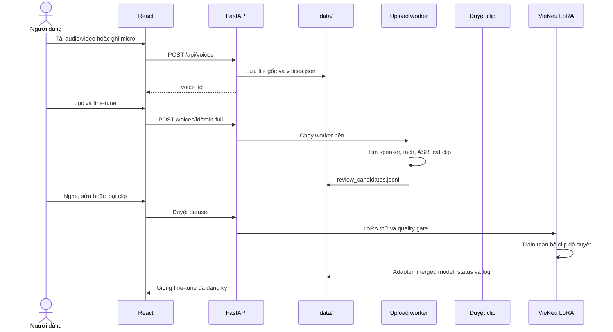

Chế độ tự động dùng Whisper tìm vùng lời nói, speaker encoder tạo embedding và phân cụm. Cụm có tổng thời lượng
lớn nhất được xem là **speaker chính trong phần lời nhận diện được**. Đây không phải nhận dạng tên hay danh tính.
Một người nói ngắn nhưng rõ có thể bị bỏ qua; một người nói nhiều giữa nhạc lớn vẫn có thể bị ASR thiếu đoạn.

Pipeline đọc file tối đa 60 phút theo các cửa sổ 300 giây có vùng chồng, không chỉ lấy 8 giây đầu. Mốc khoảng
8 giây chỉ áp dụng cho mẫu clone tức thì. Sau lọc, nếu còn dưới 5 phút hoặc 50 clip, trạng thái
`needs_more_data` được ghi và adapter cũ không bị thay.

### 2. Giữ hoặc loại bỏ một người trong audio/video

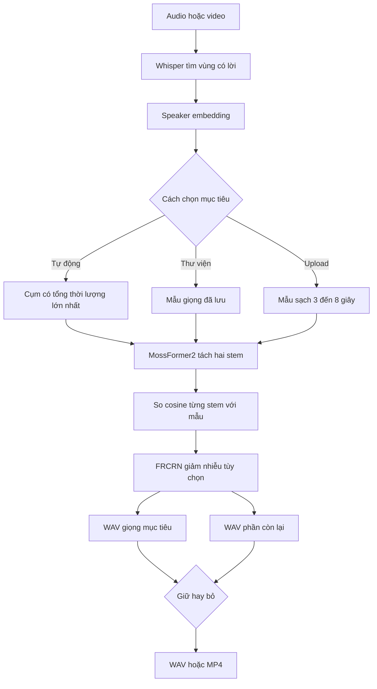

MossFormer2 làm việc ở 16 kHz nên bản sau lọc không giữ toàn bộ dải cao như nguồn 24/48 kHz. Bản bỏ giọng là phần
dư sau phép tách ước lượng, vì vậy có thể còn vết giọng. Cần nghe cả hai stem trước khi dùng làm dữ liệu train.

### 3. Speech to speech sau khi bấm dừng

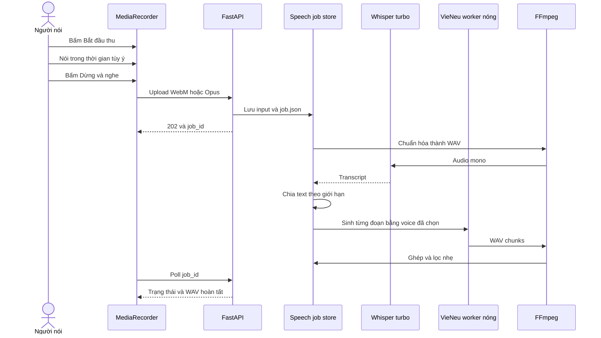

Job, input và tiến độ nằm trong `data/speech_jobs/<job-id>/`. Nếu API khởi động lại và input còn tồn tại, job chưa
xong được xếp lại. Điều này chưa phải queue phân tán; một executor trong một process vẫn là giới hạn hiện tại.

Speech to speech hiện là **ASR rồi TTS**. Hệ thống giữ nội dung qua transcript nhưng không truyền trực tiếp nhịp,
cao độ và cảm xúc của giọng nguồn như một model voice conversion end-to-end.

### 4. TTS và dựng media

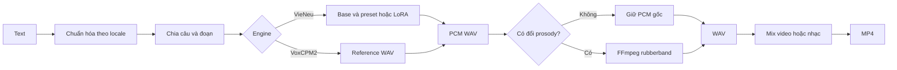

Preset MC, kể chuyện và thuyết trình chỉnh pitch, tempo, gain, nhấn và khoảng nghỉ **sau khi model sinh audio**.
Đây không phải style token hay model cảm xúc được train riêng.

### 5. STT và phụ đề

Audio/video được FFmpeg chuyển thành audio tương thích; faster-whisper nhận dạng kèm timestamp. API trả transcript
cho TXT hoặc chuyển segment sang SRT. `small` dùng trong một số luồng file/baseline; speech to speech mặc định dùng
`turbo` beam 3 theo benchmark cục bộ. Locale hỗ trợ chọn giọng và chuẩn hóa text, không bảo đảm accent bản ngữ.

## Frontend, backend và API

React giữ state giao diện; file lớn và model không chạy trong browser. `src/main.jsx` quản lý navigation, thư viện
giọng và polling training. `src/SpeechToSpeech.jsx` quản lý MediaRecorder, warmup/release model, job và phát kết quả.
`src/TrainingReview.jsx` tải từng clip để sửa nhãn. `src/Editor.jsx` tạo timeline rồi gửi file và JSON lên API.

| Nhóm | Endpoint tiêu biểu | Ý nghĩa |
| --- | --- | --- |
| Health | `GET /api/health` | API reachable; không chứng minh model đã sinh được WAV |
| Voice | `GET/POST /api/voices`, `DELETE /api/voices/{id}` | Liệt kê, tạo và xóa giọng cục bộ |
| Upload training | `POST /api/voices/{id}/train-full`, `GET /api/voices/{id}/training` | Tạo worker và theo dõi fine-tune |
| Review | `GET/PUT .../training-review`, `POST .../approve` | Nghe, sửa transcript, loại và duyệt clip |
| Corpus training | `/api/training/prepare`, `/train`, `/evaluate`, `/register` | Chuẩn bị, train, đánh giá và đăng ký run |
| Separation | `POST /api/separate`, `POST /api/target-voice` | Tách vocal/nhạc hoặc giữ/bỏ speaker |
| TTS | `POST /api/tts` | Sinh WAV/MP4 từ text và giọng |
| Speech job | `POST /api/speech-to-speech/jobs`, `GET/DELETE .../{job_id}` | Tạo, poll và xóa job chuyển giọng |
| STT | `POST /api/stt` | Nhận dạng audio/video |
| Editor | `POST /api/editor/export` | Render timeline thành WAV/MP4 |

API phục vụ một người trên máy cục bộ. Không mở port 8000 thẳng ra Internet vì chưa có đăng nhập, phân quyền voice,
quota, rate limit hoặc tách tenant.

## Lưu dữ liệu như thế nào?

Vocalab hiện **không dùng PostgreSQL, SQLite hay vector database**. Metadata/trạng thái là JSON, JSONL hoặc CSV;
audio, checkpoint và output là file. Cách này dễ đọc và backup cho một người, nhưng cần storage có transaction khi
mở rộng nhiều instance.

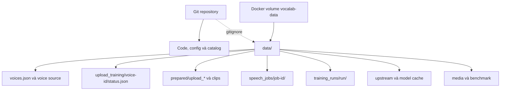

| Dữ liệu | Vị trí | Qua restart? | Vào Git? |
| --- | --- | --- | --- |
| Danh sách giọng | `data/voices.json` | Có | Không |
| File người dùng | các thư mục upload trong `data/` | Có | Không |
| Dataset đã chuẩn bị | `data/prepared/` | Có | Không |
| Trạng thái training | `data/upload_training/`, `data/training_runs/` | Có | Không |
| Speech jobs | `data/speech_jobs/` | Có; job dở có thể resume | Không |
| Model/cache | `data/upstream/`, Hugging Face cache | Có | Không |
| Catalog release | `models/catalog.json` | Có trong source | Có |

Một số JSON quan trọng được ghi qua file tạm rồi `replace` để giảm nguy cơ file nửa chừng. Đây chưa phải transaction
xuyên nhiều file. Hãy backup toàn bộ `data/` hoặc Docker volume trước khi đổi schema hay nâng cấp lớn.

## Cài đặt

Cần Linux, Python 3.10–3.13, Node.js 20+, `ffmpeg`, `ffprobe` và GPU NVIDIA CUDA cho VieNeu TTS/fine-tune. `ffmpeg -filters` cần có `rubberband` nếu muốn chỉnh pitch và tempo. Có internet lần đầu để tải model. Dự án đã chạy trên RTX 5060 Ti 16 GiB; GPU khác chưa có số đo capacity tương ứng.

```bash
git clone https://github.com/minhnhatdepzai/voice-deeplearning.git
cd voice-deeplearning
./run.sh
```

`run.sh` tạo `.venv`, cài Python/npm, build React và mở **http://127.0.0.1:8000**. Phát triển UI: `npm run dev`, mở http://127.0.0.1:5173. Muốn fine-tune hoặc cài adapter trên Release:

```bash
bash training/setup.sh
```

Script clone [VieNeu-TTS](https://github.com/pnnbao97/VieNeu-TTS) vào `data/upstream/vieneu`, pin commit `04044e1b8f822f946bafb2c88b716459f4164152` ngày 19/10/2026, cài extra `finetune`. Commit này dùng clip 3–15 giây cho recipe LoRA. `data/`, `.venv/`, `node_modules/`, `kaggle.json` không vào Git. Ứng dụng được thiết kế cho một người dùng trên máy cá nhân; API **chưa có xác thực để mở trực tiếp ra Internet**.

Để dùng tách giọng theo người nói và lọc trước khi fine-tune, cài ClearVoice trong môi trường riêng (checkpoint tự tải ở lần đầu, cần khoảng 1 GB dung lượng model):

```bash
bash training/setup_voice_filter.sh
```

Ở trang Studio, tải audio/video cần xử lý và chọn một trong ba cách: tự tìm cụm giọng có tổng thời lượng lớn nhất, chọn giọng trong thư viện, hoặc tải mẫu 3–8 giây chỉ có đúng người đó. Chọn giữ/bỏ rồi nghe hai WAV đầu ra. Với video, lựa chọn giữ/bỏ quyết định track tiếng trong MP4. Tối đa 60 phút mỗi lượt. Tỷ lệ cụm là ước tính trên phần lời nói nhận diện được, không xác minh danh tính thật. Những đoạn không đạt ngưỡng khớp giọng sẽ im trong WAV mục tiêu và vẫn nằm trong WAV còn lại. Model hai stem chạy ở 16 kHz nên bản sau lọc không còn dải tần cao của bản gốc; bản thu micro sạch ở 24 kHz trở lên vẫn là nguồn tốt hơn cho TTS. Model không bảo đảm xử lý đúng khi có trên hai người nói chồng nhau, giọng gần giống, nhạc lớn hoặc mẫu tham chiếu bẩn. Bản bỏ giọng là phần dư của bản gốc sau khi trừ stem ước lượng nên có thể còn vết giọng. Hãy nghe và kiểm tra trước khi dùng để train hoặc xuất bản.

### Cách dùng nhanh

1. Trong **Thư viện giọng**, tải bản thu tối đa 60 phút mà bạn được phép sử dụng. Với phỏng vấn nhiều người, chọn **Tự tìm người có tổng thời lượng nói nhiều nhất**; với mẫu sạch, có thể tự chọn điểm bắt đầu cho đoạn 3–8 giây.
2. Nghe mẫu trên thẻ giọng. Có thể **Thêm bản thu sạch cùng người nói** nhiều lần; các file trùng nội dung bị từ chối. Bấm **Lọc và fine-tune lại từ tất cả bản thu** khi đủ dữ liệu. Worker lọc từng file theo mẫu rồi phiên âm. Khi đủ 5 phút và 50 đoạn, thẻ giọng hiển thị các clip để nghe, sửa lời hoặc bỏ đoạn lẫn người/nhiễu; bấm **Đã duyệt clip · bắt đầu train** mới cho LoRA chạy. Nếu sau lọc hoặc sau duyệt còn quá ít dữ liệu, adapter cũ vẫn được giữ.
3. Trong **Studio**, chọn `Tiếng Việt tự nhiên` hoặc `English · General American`, nhập thoại, chọn VieNeu/VoxCPM2 và xuất WAV/MP4.
4. Trong **Speech to speech**, chọn giọng đã train rồi bấm **Bắt đầu thu**. Nói liên tục và nghỉ tùy ý; ứng dụng không tự chốt theo khoảng im lặng. Khi nói xong, bấm **Dừng & nghe** để gửi một job xử lý và phát lại. Job lưu tiến độ trên đĩa và tiếp tục sau khi tải lại trang hoặc khởi động lại API nếu file đầu vào còn đó. Không có giới hạn số giây cố định; tải lên vẫn giới hạn 500 MB và trình duyệt giữ bản ghi trong bộ nhớ tới lúc bấm dừng. Đeo tai nghe để tránh micro thu lại loa.
5. Trong **Chuyển lời nói**, tải audio/video để lấy TXT/SRT. Trong **Chỉnh sửa media**, thêm clip và WAV AI để xuất bản phối mới.

## Model và vai trò

| Thành phần | Công nghệ | Tác dụng | Đã fine-tune trong dự án? |
| --- | --- | --- | --- |
| TTS chính | [VieNeu-TTS v3 Turbo](https://huggingface.co/pnnbao-ump/VieNeu-TTS-v3-Turbo) | Sinh giọng Việt/Anh bằng text và mẫu speaker | **Có**, LoRA theo speaker |
| TTS tham chiếu | [VoxCPM2](https://github.com/OpenBMB/VoxCPM) | Clone tức thì từ WAV tham chiếu | **Không**, chỉ inference |
| STT | [faster-whisper `small` / `turbo`](https://github.com/SYSTRAN/faster-whisper) | `small` cho file/baseline cũ; `turbo` giữ nóng cho speech to speech | **Không**, pretrained; có thể đổi `WHISPER_MODEL` |
| Tách âm | [Demucs `htdemucs`](https://github.com/facebookresearch/demucs) | Vocal và nhạc nền | **Không** |
| Tách người/giảm nhiễu | [ClearVoice MossFormer2_SS_16K và FRCRN_SE_16K](https://github.com/modelscope/ClearerVoice-Studio/blob/main/clearvoice/README.md) | Hai stem lời nói và giảm nhiễu | **Không**; pretrained |
| Speaker embedding | Encoder của VieNeu | Đặc trưng âm sắc, chọn mẫu/preset, cosine | **Không**, encoder đóng băng |
| Media/prosody | FFmpeg + `rubberband` | Cắt/ghép, pitch, tempo, âm lượng, xuất file | Không phải model học máy |

VieNeu base model từ Hugging Face được tải khi cần, không chứa trong repo. LoRA lưu cập nhật nhỏ cho model đó; adapter riêng **không chạy được nếu thiếu base**. VoxCPM2 không đọc adapter VieNeu. Chọn `en-US`/`vi-VN` giúp chọn giọng và chuẩn hóa text; nó không thể tự biến giọng vùng khác thành giọng bản ngữ.

### Có RAG không? RAG gì?

**Không có RAG.** RAG cần kho tài liệu, bước truy hồi theo truy vấn và đưa tài liệu tìm được vào model sinh. Dự án không có vector database, document chunking, retriever hay augmented prompt. `speaker_embedding` là vector biểu diễn âm sắc để điều kiện hóa giọng và tính tương đồng; đó **không phải** embedding tài liệu hay vector search. Transcript từ Whisper dùng cho STT/nhãn train, không phải knowledge base.

## Fine-tuning: dữ liệu, thuật toán và kiểm chứng

1. **Thu thập:** chọn từng speaker riêng từ VIVOS/LibriTTS/LJ Speech/EmoV, hoặc lấy file người dùng. Corpus công khai có audio-text ghép cặp; file người dùng được faster-whisper tạo transcript tự động.
2. **Tiền xử lý:** FFmpeg chuyển về WAV mono 24 kHz. `training/pipeline.py` lọc clip ngoài 3–15 giây, clip không phù hợp/trùng và chia train/validation/test theo câu. `training/uploaded_audio.py` đọc file dài từng khúc 300 giây có chồng biên, lấy word timestamps, cắt thành các câu ngắn vừa giới hạn recipe. Mỗi file tải qua giao diện dài tối đa 60 phút; im lặng/nhạc hoặc lời ASR bỏ sót không tạo mẫu train.
3. **Mã hóa:** `training/run.py` gọi `finetune/prepare_dataset.py` của VieNeu để tạo Parquet text + mã audio. ONNX codec/speaker encoder upstream vẫn dùng CPU ở bước này; optimizer LoRA chạy CUDA. GPU cao không đồng nghĩa mọi bước đều chạy GPU.
4. **LoRA:** gọi `finetune/train_lora.py` upstream, học cập nhật hạng thấp trên backbone hoặc cả acoustic decoder (`target=all`), giữ phần lớn base cố định. Về mặt toán học, cập nhật một ma trận gần đúng `ΔW = (alpha/r) · B A`. Các run đầu thường `rank=16`, `target=backbone`, batch 2; run dài thường `rank=32`, `target=all`, batch 14, gradient accumulation 2. **Cấu hình và số optimizer updates chính xác của từng run nằm trong [catalog](models/catalog.json)**, không phải tất cả chạy một cấu hình.
5. **Checkpoint:** lưu `adapter_model.safetensors`, config/tokenizer, merge với base, tạo preset speaker. Script nạp lại adapter trong tiến trình mới và so SHA-256 model merge. Catalog chỉ lấy run `evaluated` đã cold-reload thành công.
6. **Đánh giá:** với corpus công khai, sinh WAV từ test chưa train, dùng Whisper đo WER/CER trên cả WAV gốc và WAV AI; encoder speaker tính cosine với mẫu enroll. Đây là chỉ số **proxy**, không thay bài nghe người thật về tự nhiên, accent, ngữ điệu và mức giống người nói.

**File upload và giới hạn 8 giây:** VieNeu clone tức thì dùng tối đa khoảng 8 giây tham chiếu theo code upstream. File nguồn tối đa 60 phút và pipeline **fine-tune** đọc từ đầu đến cuối. Chế độ tự động dùng Whisper tìm đoạn lời nói, VieNeu speaker embedding phân cụm và chọn cụm có tổng thời lượng lớn nhất để lấy mẫu tham chiếu. Khi train từ giao diện, worker lọc theo mẫu đó trước ASR và LoRA; đoạn không khớp giọng không đưa vào dữ liệu train. Nếu sau lọc còn dưới 5 phút hoặc 50 đoạn, trạng thái là `needs_more_data` và adapter hiện có không bị thay. Với dữ liệu đủ, bản train thử dùng ít nhất 5 câu test tách riêng; nếu WER AI cao hơn WAV gốc quá 20 điểm phần trăm, trạng thái là `needs_review` và worker dừng trước khi thay adapter. API cũ `/train-full` không có `?clean=true` vẫn chạy pipeline gốc. **Model cuối được train lại trên toàn bộ clip nhận diện được, không giữ test split riêng**. Không được trình bày WER precheck như WER held-out của model cuối. File dài chỉ giúp khi có nhiều lời sạch, đúng một người nói và transcript chính xác. Việc tách/lọc tự động có thể làm mất âm tiết hoặc nhận nhầm người; hãy nghe mẫu, sửa transcript và thu thêm lời sạch trước khi xem adapter mới tốt hơn.

**Độ tự nhiên của TTS:** chế độ `Tự nhiên` giữ nguyên PCM do model sinh nếu pitch/tempo/gain ở mặc định, tránh thêm biến dạng từ `rubberband`. Các phong cách có chỉnh nhịp/cao độ vẫn qua FFmpeg. Bản ghi nhiều tiếng ù/đường phố, chỉ 2–3 phút lời nói hoặc nhãn ASR sai không thể khắc phục chỉ bằng tăng số bước LoRA; nên ưu tiên thu thêm 10–30 phút một người, phòng yên tĩnh, mic ổn định, nghe và sửa nhãn. Chưa có MOS/ABX hoặc phép thử đủ mạnh để tuyên bố một giọng fine-tune cụ thể đã đạt chất lượng người thật.

**Diễn cảm MC/thuyết trình/kể chuyện:** preset và điều khiển từng dòng áp dụng pitch, tempo, âm lượng, nhấn/ngắt nghỉ, lên/xuống giọng cuối câu **sau khi TTS sinh audio** bằng FFmpeg `rubberband`. Chúng không phải style token hoặc model cảm xúc đã train riêng. Tiếng Việt chuẩn và Anh Mỹ phụ thuộc giọng mẫu, dữ liệu và text; chọn locale không bảo đảm accent.

### Luồng kiểm soát chất lượng training

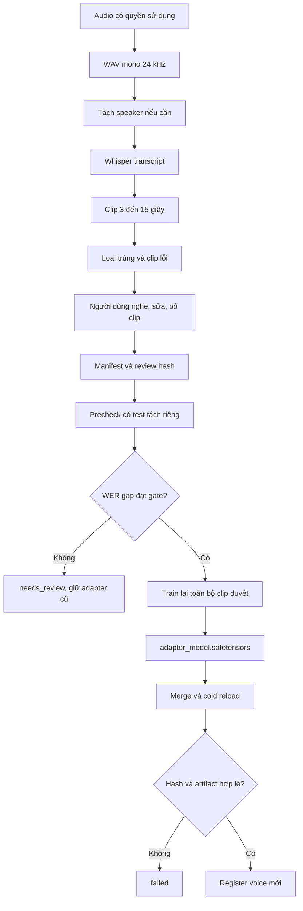

### Adapter được kiểm tra thế nào?

`training/run.py` gọi recipe VieNeu để tạo Parquet, train LoRA, merge model và tạo speaker preset. Một run chỉ hoàn
thành khi có adapter, config, log chứa optimizer step và merged model. Script merge lại adapter trong thư mục mới,
so SHA-256 với bản merge từ training rồi mới ghi `adapter_reload_verified=true`.

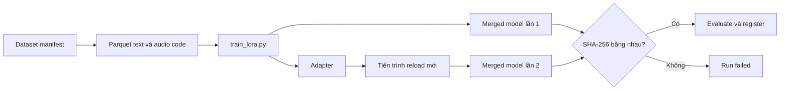

### Mười ghi chú quan trọng khi training

1. Chỉ dùng bản ghi bạn sở hữu hoặc được người nói cho phép. MIT của mã nguồn không cấp quyền dùng giọng, dataset
   hoặc checkpoint bên ngoài.
2. Chất lượng nguồn quan trọng hơn số step. Tiếng đường phố, reverb, clipping, nhiều người và transcript sai có
   thể được model học lại thành lỗi.
3. Nên có 10–30 phút lời sạch, một speaker, mic và phòng tương đối ổn định. Mức 5 phút/50 clip chỉ là gate kỹ thuật.
4. Nghe và duyệt clip. Denoise hoặc separation có thể làm mất phụ âm, đổi âm sắc và tạo artifact.
5. Không đưa cùng câu hoặc cùng đoạn ghi vào train lẫn test. Chia theo nội dung để giảm data leakage.
6. Theo dõi loss để phát hiện bất thường; loss thấp không chứng minh giọng tự nhiên hay giống người.
7. So base, adapter cũ và candidate trên cùng tập câu có dấu, số, tên riêng, câu dài và câu dễ vấp.
8. Kiểm tra adapter bằng tiến trình mới; train xong trong cùng process chưa chứng minh artifact deploy được.
9. Giữ manifest, commit upstream, config, checksum và license cùng adapter để tái tạo và audit.
10. Không promote chỉ vì một metric tốt: WER có thể tốt nhưng âm sắc sai; cosine cao nhưng lời vẫn máy móc.

## Dataset, giấy phép và nguồn huấn luyện

| Dataset | Ngôn ngữ | Vai trò | Quyền sử dụng nguồn |
| --- | --- | --- | --- |
| [VIVOS Zenodo](https://zenodo.org/records/7068130), [Kaggle mirror](https://www.kaggle.com/datasets/kynthesis/vivos-vietnamese-speech-corpus-for-asr) | Việt | LoRA theo speaker, test | Bản gốc CC BY-NC-SA 4.0, nghiên cứu phi thương mại; metadata mirror khác, áp điều kiện bản gốc |
| [LibriTTS dev-clean](https://www.openslr.org/60/) | Anh | LoRA theo speaker, test | CC BY 4.0, cần ghi công |
| [LJ Speech 1.1](https://keithito.com/LJ-Speech-Dataset/) | Anh | LoRA speaker LJ, run dài | Public domain tại Mỹ; kiểm tra quy định nơi sử dụng |
| [EmoV-DB](https://github.com/numediart/EmoV-DB) | Anh | LoRA Jenie · Amused | [Nghiên cứu/giảng dạy/thử nghiệm cá nhân phi thương mại](https://github.com/numediart/EmoV-DB/blob/master/LICENSE.md) |
| [FPT Open Speech](https://data.mendeley.com/datasets/k9sxg2twv4/4), [Kaggle mirror](https://www.kaggle.com/datasets/thinh127/fpt-open-speech-dataset-fosd-vietnamese) | Việt | **Chỉ benchmark STT** | Mirror thiếu speaker ID tin cậy; không dùng fine-tune TTS |

`training/sources.json` lưu URL và điều kiện nguồn. VIVOS, LibriTTS và các speaker khác được train thành **adapter riêng**, không gộp người nói. Cần xem giấy phép riêng của dataset và base model; checkpoint công khai **không cấp thêm quyền thương mại hoặc mạo danh người nói**.

Ví dụ tải và train một speaker Việt:

```bash
# Đặt kaggle.json cá nhân trong thư mục dự án; file đã bị gitignore.
uv pip install --python .venv/bin/python kaggle
mkdir -p data/datasets/vivos
KAGGLE_CONFIG_DIR="$PWD" .venv/bin/kaggle datasets download -d kynthesis/vivos-vietnamese-speech-corpus-for-asr -p data/datasets/vivos
python3 training/pipeline.py speakers --source vivos --archive data/datasets/vivos/vivos-vietnamese-speech-corpus-for-asr.zip
python3 training/pipeline.py prepare --source vivos --archive data/datasets/vivos/vivos-vietnamese-speech-corpus-for-asr.zip --speaker VIVOSSPK13 --output data/prepared/vivos_VIVOSSPK13 --max-clips 300
.venv/bin/python -m training.run --dataset data/prepared/vivos_VIVOSSPK13 --steps 90 --run my_vivos_spk13
.venv/bin/python -m training.evaluate --run-dir data/training_runs/my_vivos_spk13 --train-python data/upstream/vieneu/.venv/bin/python --count 20
```

`training/auto_train.py`, `training/extended_train.py`, `training/self_train.py` và `training/upload_train.py` điều phối các luồng train. Worker dùng khóa GPU để tránh nhiều model nặng cùng chạy. Batch lớn có thể OOM tùy VRAM còn trống và chiều dài mẫu; kiểm tra `nvidia-smi` và trạng thái/log run trước khi kết luận GPU có hoạt động.

## Checkpoint đã fine-tune: tải và sử dụng

[Release `v0.1.0-models`](https://github.com/minhnhatdepzai/voice-deeplearning/releases/tag/v0.1.0-models) có **15 archive LoRA** từ 4 corpus công khai. Mỗi archive có `adapter/adapter_model.safetensors`, `adapter_config.json`, tokenizer, `voices_v3_turbo.json`, một WAV **do model sinh**, và `metadata.json`. [Catalog](models/catalog.json) ghi SHA-256 asset/adapter/preset, source/license, số clip/bước, WER/cosine. Checkpoint trung gian, merged base, raw dataset, file tải lên của người dùng và adapter học từ các file upload **không được công bố**.

```bash
bash training/setup.sh
.venv/bin/python scripts/install_public_model.py vivos_vi_spk17_extended_b14
.venv/bin/python scripts/install_public_model.py ljspeech_en_lj_extended_b14
```

Installer tải và so SHA-256, giải nén an toàn, merge với VieNeu base, chép preset, rồi đăng ký giọng vào Studio nếu API đang chạy. Nếu server chưa chạy, mở `./run.sh`, sau đó dùng trang **Huấn luyện AI** hoặc gửi `POST /api/training/register` với JSON `{"run":"vivos_vi_spk17_extended_b14"}`. Có thể dùng asset đã tải qua `--asset /duong/dan/run.tar.gz`. LoRA **không** là model độc lập; cần base VieNeu và môi trường CUDA để merge/inference.

## Kết quả kiểm thử và cách đọc số liệu

[TRAINING_REPORT.md](TRAINING_REPORT.md), [benchmark phỏng vấn tiếng Anh](docs/ENGLISH_INTERVIEW_BENCHMARK_2026-10-22.md) và [models/catalog.json](models/catalog.json) lưu kết quả từng giọng. Bảy run đầu có 1.603 clip train (~97,8 phút) và validation/test riêng. Ví dụ VIVOSSPK15: trên 19 câu test, WER khi Whisper đọc WAV gốc **13,6%**, WAV AI **11,7%**; cosine gốc với mẫu enroll **0,735**, AI với mẫu enroll **0,741**. Đây là một tập test của một speaker, không phải cam kết chất lượng mọi giọng. Các run mở rộng có số liệu riêng trong catalog.

Benchmark STT độc lập FPT Open Speech: faster-whisper `small` trên 60 câu Việt có WER **35,3%** (Set001 **29,5%**, Set002 **40,1%**). Whisper chưa được fine-tune. WER của TTS chịu cả lỗi tổng hợp âm lẫn lỗi ASR; cosine không chứng minh danh tính hay độ tự nhiên. Không so trực tiếp WER giữa hai speaker có câu test khác nhau để xếp hạng chất lượng.

Benchmark tương tác ngày 22/10/2026 dùng 19 câu test VIVOSSPK15 chưa dùng trong các adapter upload: `small` beam 1 đạt WER **13,58%** trong 2,24 giây tổng inference; `turbo` beam 3 đạt **4,32%** trong 3,74 giây, còn beam 5 có cùng WER nhưng chậm hơn. Vì vậy trang Speech to speech mặc định `turbo` beam 3 và giữ model trong VRAM. Với giọng upload `abc · Fine-tune toàn file`, 19 lượt HTTP đầy đủ sau warmup có WER đầu vào **4,94%**, WER đọc lại đầu ra **9,26%**, cosine giọng trung bình **0,527** và thời gian xử lý trung bình **0,55 giây/lượt**. Các số latency này đo trên câu ngắn; chế độ hiện tại bắt đầu xử lý khi người dùng chủ động bấm dừng. Lọc nhẹ FFmpeg giảm noise-floor proxy từ **−59,24** xuống **−61,39 dBFS**, WER không xấu đi trong phép thử. Đây vẫn không phải MOS/ABX hay bằng chứng giọng giống người thật.

## Đánh giá chất lượng đúng cách

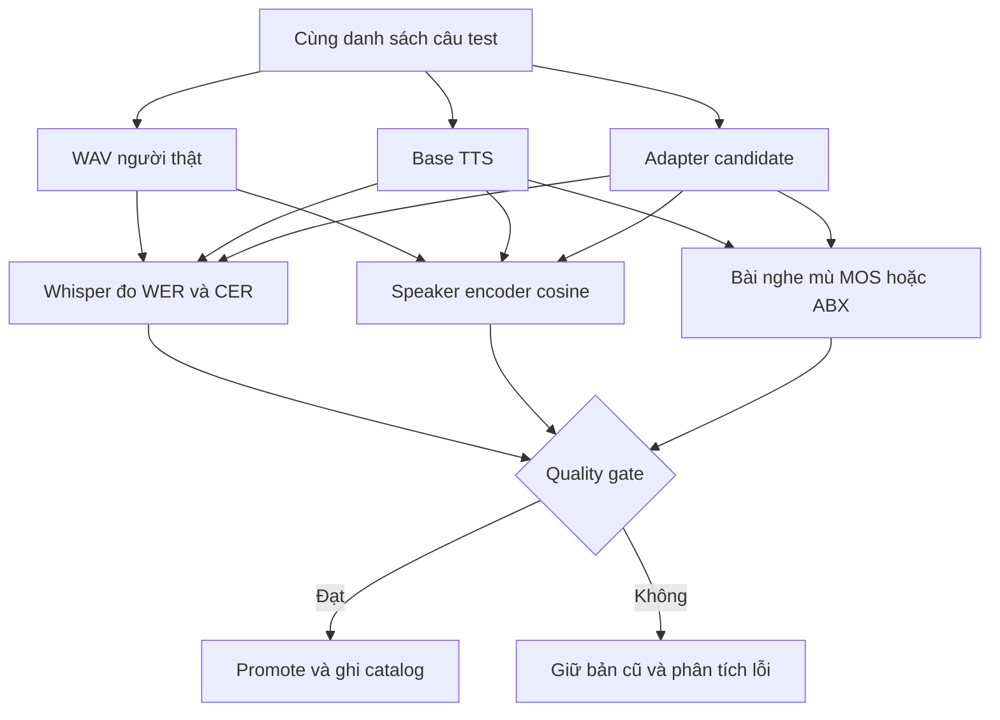

| Chỉ số | Đo điều gì | Không chứng minh điều gì |
| --- | --- | --- |
| WER | Tỷ lệ lỗi từ khi ASR đọc WAV | Chất giọng giống người hoặc cảm xúc tự nhiên |
| CER | Tỷ lệ lỗi ký tự, hữu ích với tiếng Việt | Chất lượng âm học tổng thể |
| Speaker cosine | Độ gần embedding âm sắc | Danh tính pháp lý hoặc người nghe chắc chắn nhận đúng |
| F0 | Đặc trưng cao độ | Nhịp, biểu cảm và tự nhiên đầy đủ |
| Noise floor proxy | Năng lượng ở vùng yên | Artifact, reverb hoặc tiếng ồn có chủ ý |
| Latency | Thời gian trong cấu hình đo | Throughput nhiều người hoặc tốc độ máy khác |
| MOS/ABX | Đánh giá nghe của con người | Không đáng tin nếu ít người nghe hoặc thiết kế test lệch |

Muốn kết luận một model tốt hơn, cần khóa phần cứng, model, câu test và cách warmup; báo sample size cùng p50/p95
latency; so base, adapter cũ và candidate; đo cả lỗi phát âm, độ gần speaker và bài nghe mù. Một WAV đẹp hoặc một
metric đơn lẻ không đủ để promote.

## Docker và đóng gói

Docker image dùng hai stage: Node 22 build React; Python 3.12 cài dependency runtime rồi nhận `dist/`. `tini` làm
PID 1 để chuyển signal. Dữ liệu và model nằm ngoài image trong named volume.

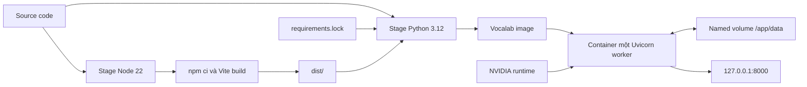

Cần Docker Engine, Compose v2 và NVIDIA Container Toolkit. Kiểm tra GPU rồi chạy:

```bash
docker run --rm --gpus all nvidia/cuda:12.8.1-base-ubuntu24.04 nvidia-smi
cp .env.example .env
docker compose up -d --build
docker compose logs -f vocalab
```

Mở `http://127.0.0.1:8000`. Lần đầu bootstrap môi trường VieNeu/ClearVoice và tải model có thể tốn nhiều phút;
nên dành ít nhất 25 GB cho môi trường, cache và checkpoint. Health check chỉ cho biết API trả lời; hãy sinh một WAV
thật để xác nhận inference.

Compose mount `vocalab-data` vào `/app/data`, giới hạn log và bind port vào localhost. `data/` trong checkout host
không tự được copy vào volume. `VOICE_STUDIO_BOOTSTRAP_MODE=skip` chỉ phù hợp smoke test API; inference vẫn cần
model và môi trường upstream.

### Cập nhật và backup

```bash
git pull --ff-only
docker compose up -d --build
```

```bash
docker run --rm \
  -v voice-deeplearning_vocalab-data:/data:ro \
  -v "$PWD":/backup \
  ubuntu:24.04 \
  tar -C /data -czf /backup/vocalab-data.tar.gz .
```

Kiểm tra tên volume bằng `docker volume ls` nếu tên project Compose khác. Backup có thể chứa giọng nói và model
riêng tư; cần quản lý quyền truy cập như dữ liệu nhạy cảm.

## CI/CD và cách đóng góp

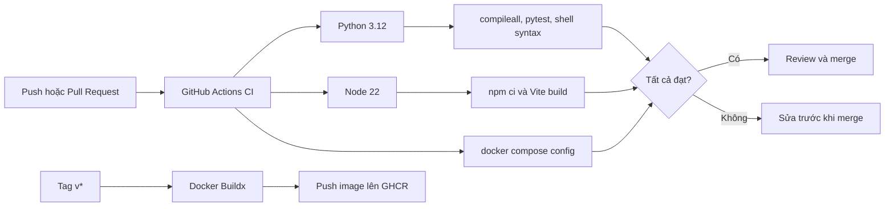

Workflow CI chạy khi push `main`, pull request hoặc thủ công:

```bash
python -m compileall -q server training
python -m pytest -q
npm ci
npm run build
docker compose config -q
```

CI không có GPU inference và không nghe audio, nên badge xanh không chứng minh model sinh đúng giọng. Thay đổi
pipeline âm thanh cần thêm mẫu thật trên host GPU và báo input, output, cấu hình cùng metric phù hợp.

Tag `v*` kích hoạt Buildx và push image lên GHCR. Image chứa code và dependency ứng dụng; không chứa file ghi âm,
raw dataset, adapter riêng hoặc checkpoint tải về. Khi đóng góp, dùng mẫu có quyền sử dụng, không commit secrets và
ghi rõ ảnh hưởng dữ liệu/migration. Xem [CONTRIBUTING.md](CONTRIBUTING.md).

## Vận hành và xử lý lỗi

| Hiện tượng | Kiểm tra | Hướng xử lý |
| --- | --- | --- |
| Health xanh nhưng không có WAV | worker log, CUDA, model path, request thật | chạy một lượt TTS; health không load toàn bộ model |
| CUDA out of memory | `nvidia-smi`, process train/inference, batch | chờ khóa GPU, dừng process thừa; upload worker hạ batch 14→8 |
| Speech job đứng sau restart | `data/speech_jobs/<id>/job.json`, input còn không | API requeue job có input; job mất input phải tạo lại |
| Training container bị ngắt | status upload và `data/worker_logs/` | trạng thái được đánh dấu failed để retry; optimizer không tự resume |
| Giọng bị ù hoặc tiếng đường phố | raw clip, stem, transcript, reverb | thu sạch hơn, loại clip xấu và review nhãn; tăng step không sửa nguồn bẩn |
| Giọng khác người mục tiêu | voice đã chọn, reference, cosine, clip lẫn | refresh reference, chọn mẫu sạch và lọc lại |
| Mất phụ âm sau tách | so raw với stem 16 kHz | bỏ stem lỗi; ưu tiên bản thu trực tiếp sạch |
| Text dài bị vấp | transcript, chunk, dấu câu, tên riêng | chia câu, sửa text và benchmark cùng danh sách câu |
| Docker không thấy GPU | NVIDIA Toolkit và lệnh `nvidia-smi` trong container | cấu hình runtime NVIDIA rồi restart Docker |
| Port 8000 bận | process/container hiện tại | đặt `VOCALAB_PORT=8001` trong `.env` |

Khóa GPU ngăn training và inference nặng chạy đồng thời trong app, nhưng không quản lý process CUDA khởi động bên
ngoài. Kiểm tra `nvidia-smi`, worker log và trạng thái run trước khi kết luận model treo.

## Cấu trúc mã nguồn

```text
voice-deeplearning/
├── src/                         React UI
├── server/                      FastAPI, jobs, media, speaker và inference
├── training/                    prepare, review, LoRA, evaluation, benchmark
├── tests/                       regression tests không cần GPU nặng
├── scripts/                     container smoke, package/install adapter
├── models/catalog.json          metadata và checksum adapter công khai
├── docs/                        kiến trúc, deployment và báo cáo validation
├── data/                        runtime cục bộ, bị loại khỏi Git
├── Dockerfile                   multi-stage frontend + backend image
├── compose.yaml                 GPU, volume, healthcheck, restart và logs
├── requirements.lock            Python runtime đã khóa phiên bản
├── package-lock.json            frontend dependency đã khóa phiên bản
└── run.sh                       launcher local
```

| Muốn thay đổi | Bắt đầu ở | Cần kiểm tra |
| --- | --- | --- |
| Thu âm và job UX | `src/SpeechToSpeech.jsx`, `server/speech_jobs.py` | test job + browser recording thật |
| ASR/TTS profile | `server/speech_to_speech.py`, `server/realtime_voice.py` | held-out benchmark + nghe so sánh |
| Chọn/tách speaker | `server/target_voice.py`, `server/dominant_speaker.py` | clip gán nhãn, overlap và residual |
| Dataset/review | `training/uploaded_audio.py`, `training/dataset_review.py` | split, manifest, hash và reload |
| LoRA | `training/run.py`, upstream pin | optimizer step, artifact, cold reload, evaluation |
| Media editor | `src/Editor.jsx`, `server/media_edit.py`, `server/timeline.py` | duration, sync và codec |
| Container | `Dockerfile`, `compose.yaml`, entrypoint | smoke API rồi GPU inference thật |

## Thuật ngữ cần biết

| Thuật ngữ | Giải nghĩa trong dự án |
| --- | --- |
| API / endpoint | Giao diện HTTP / một đường dẫn và phương thức cụ thể |
| Frontend / backend | React trong browser / FastAPI xử lý dữ liệu, job và model |
| STT / ASR | Speech-to-Text: tiếng nói thành chữ |
| TTS | Text-to-Speech: chữ thành tiếng nói |
| Speech to speech | Audio → transcript → audio bằng giọng khác trong implementation hiện tại |
| Voice conversion | Đổi trực tiếp từ audio và thường giữ timing/prosody; Vocalab chưa dùng kiểu end-to-end này |
| Speaker embedding | Vector số biểu diễn đặc trưng âm sắc |
| Cosine similarity | Độ gần hướng giữa hai embedding |
| Diarization | Xác định ai nói lúc nào; repo chưa có diarization tổng quát đầy đủ |
| Source separation / stem | Tách nguồn âm / một track ước lượng sau tách |
| Denoise | Giảm nhiễu, có thể đồng thời làm mất chi tiết giọng |
| Sample rate / bitrate | Số mẫu mỗi giây / lượng dữ liệu mã hóa mỗi giây |
| PCM / codec | Mẫu âm thanh thô / cách mã hóa như Opus, AAC, H.264 |
| Transcript / timestamp | Lời dạng chữ / mốc thời gian của từ hoặc đoạn |
| Dataset / manifest | Tập dữ liệu / file mô tả clip, text, split và nguồn |
| Train / validation / test | Tập học / chọn cấu hình / đánh giá giữ riêng |
| Data leakage | Thông tin test lọt vào train, làm số đo đẹp giả |
| Pretrained / fine-tuning | Model đã học trước / học thêm từ dữ liệu hẹp |
| LoRA / adapter | Cập nhật hạng thấp / file trọng số bổ sung cần base model |
| Checkpoint / merge | Trạng thái model lưu / kết hợp base và adapter |
| Cold reload | Nạp artifact trong tiến trình hoặc thư mục mới để kiểm tra deploy |
| Batch / gradient accumulation | Mẫu mỗi lượt / cộng gradient qua nhiều mini-batch |
| Learning rate / overfitting | Độ lớn bước học / nhớ train nhưng kém trên dữ liệu mới |
| WER / CER | Tỷ lệ lỗi từ / ký tự do ASR đo |
| F0 / MOS / ABX | Cao độ cơ bản / điểm người nghe / bài nghe so sánh |
| Latency / throughput | Thời gian một việc / số việc trong một khoảng thời gian |
| Worker / queue | Tiến trình nền / hàng chờ công việc |
| Artifact / SHA-256 | File đầu ra deploy được / hash kiểm tra đúng byte |
| Provenance | Nguồn gốc dữ liệu, code, cấu hình và artifact |
| Image / container / volume | Gói chạy / tiến trình từ image / vùng dữ liệu bền vững |
| CI/CD | Tự động kiểm thử và đóng gói/phát hành |

## Phụ lục kiến thức chuyên sâu

<details>
<summary><strong>Mở bộ câu hỏi và trả lời kỹ thuật</strong></summary>

**Bạn đã tự huấn luyện gì?** LoRA của VieNeu-TTS v3 Turbo theo từng speaker. Tôi không huấn luyện từ đầu VieNeu, VoxCPM2, Whisper hoặc Demucs. Adapter `.safetensors` và cấu hình/số bước từng run có trong Release/catalog.

**Tại sao LoRA?** Nó chỉ tối ưu cập nhật hạng thấp, làm checkpoint nhỏ và giảm tham số phải học. Kết quả vẫn phụ thuộc audio sạch, một speaker nhất quán, transcript đúng và đánh giá ngoài tập train.

**Có RAG hoặc vector DB không?** Không. Speaker embedding là đặc trưng âm sắc, không phải cơ chế truy hồi tài liệu.

**File dài có bị cắt 8 giây?** Không khi fine-tune: pipeline đọc toàn bộ file tối đa 60 phút, chia các phần lời được nhận diện, model cuối dùng mọi clip đạt chuẩn. Tám giây chỉ là tham chiếu clone tức thì. Im lặng, nhạc, lời của cụm khác, hoặc lời ASR bỏ sót không trở thành dữ liệu train.

**Tại sao file giọng nữ có thể ra giọng khác?** Kiểm tra Studio chọn đúng **giọng fine-tune** và model VieNeu, trạng thái run/số clip/hash adapter, nghe mẫu WAV. File pha nhiều người, nhạc, transcript sai hoặc dữ liệu quá ít có thể làm adapter lệch. Cosine, F0 và ASR là tín hiệu kiểm tra, không chứng minh giọng giống hệt.

**Đánh giá ra sao?** Với corpus công khai, tách train/validation/test; sinh WAV test, đo WER/CER bằng ASR và cosine bằng encoder speaker; nạp lại adapter rồi so hash model merge. Model upload cuối train toàn bộ clip nên không tự nhận có test held-out.

**Giới hạn hiện tại?** Công cụ tách theo giọng tham chiếu xử lý tối đa hai stem và có thể nhầm khi giọng chồng/giống nhau; chưa có diarization tổng quát hoặc bước sửa transcript thủ công trong pipeline upload, chưa làm MOS/ABX với người nghe hoặc benchmark accent tổng quát, chưa có xác thực đa người dùng. Editor là timeline cơ bản.

**Vì sao speech to speech dùng job thay vì giữ request HTTP tới cuối?** Bản ghi dài cần ASR, nhiều lượt TTS và ghép
file. Job trả `job_id` sớm, lưu trạng thái trên đĩa và cho frontend poll; input còn thì có thể xếp lại sau restart.

**Tại sao chỉ chạy một Uvicorn worker?** Executor và queue hiện nằm trong process. Nhiều worker tạo nhiều queue độc
lập và có thể tranh GPU hoặc cùng cập nhật file. Muốn scale cần queue chung, distributed lock và storage phù hợp.

**Dự án lưu database ở đâu?** Không có RDBMS. `data/` dùng JSON/JSONL/CSV và file media/checkpoint. Đây là file
store local cho một người, không nên gọi `voices.json` là database production.

**Khi nào nên dùng PostgreSQL, Redis và object storage?** Khi có nhiều người dùng hoặc nhiều instance, cần
transaction, phân quyền, audit và queue phân tán. PostgreSQL phù hợp metadata; Redis/Celery/RQ điều phối job;
S3-compatible storage giữ media và artifact lớn.

**Speech to speech có giữ cảm xúc giọng gốc không?** Không đầy đủ. ASR biến audio thành text nên timing, pitch và
cảm xúc nguồn bị mất phần lớn; TTS sinh lại theo giọng đích và preset.

**Tại sao không chỉ denoise rồi train?** Denoise giảm nhiễu nhưng không loại lời người khác. Phỏng vấn cần chọn và
tách speaker, rồi vẫn phải nghe để phát hiện mất âm tiết hoặc artifact.

**Làm sao tìm người nói nhiều nhất?** Whisper tìm vùng lời, encoder tạo embedding, thuật toán gom các embedding gần
nhau và cộng thời lượng. Cụm lớn nhất là speaker chính theo phần lời hệ thống nhận diện được.

**Tăng số step có luôn tốt hơn không?** Không. Dataset nhỏ hoặc bẩn dễ overfit; model có thể nhớ noise, lỗi transcript
hoặc câu train. Phải so candidate trên câu mới và nghe kết quả.

**WER thấp tại sao vẫn nghe giả?** WER chỉ xem ASR đọc đúng từ. Audio đều đều, metallic, sai nhịp hoặc khác người
vẫn có thể được ASR chép đúng.

**Multi-stage Docker build để làm gì?** Node build frontend ở stage riêng; runtime lấy `dist/` và Python dependency.
Image chạy không cần toàn bộ toolchain frontend và dễ tái tạo hơn.

**Container restart giữ gì, mất gì?** Named volume giữ `data/`. Speech job còn input có thể requeue. Training process
bị ngắt không tự resume optimizer; trạng thái được đánh dấu để người dùng retry.

**CI hiện kiểm tra gì?** Compile Python, pytest, shell syntax, Vite production build và Compose config. CI không chạy
model GPU, không đo GPU latency và không chấm chất lượng nghe.

**Đưa lên production còn thiếu gì?** Xác thực, tenant/role, quota, rate limit, object storage, database, distributed
queue/lock, observability, retention/delete policy, secret manager, backup/restore drill, capacity test và audit
quyền sử dụng giọng.

**Trình bày dự án trong hai phút thế nào?** Vocalab là studio giọng local React/FastAPI. Whisper lấy transcript;
speaker embedding và ClearVoice lọc người nói; VieNeu cùng LoRA tạo giọng; FFmpeg dựng WAV/MP4. Job dài được lưu
trên đĩa, GPU được serialize, adapter được cold-reload và checksum. Docker giữ dữ liệu trong volume, CI test/build
và tag phát hành GHCR. Giới hạn lớn nhất là file store một người, separation hai stem và chưa có MOS/ABX đủ lớn.

</details>

## Mã nguồn và tài liệu gốc

- `src/`: React UI; `src/SpeechToSpeech.jsx` thu thủ công bằng MediaRecorder và chỉ gửi khi người dùng bấm dừng. `server/app.py`: API, thư viện giọng và job; `server/realtime_voice.py` giữ VieNeu worker nóng. `server/media_edit.py`, `server/prosody.py`: timeline/điều khiển audio.
- `training/pipeline.py`, `training/uploaded_audio.py`: chuẩn bị corpus/file dài. `training/run.py`: LoRA. `training/evaluate.py`, `training/speaker_similarity.py`: đánh giá. `training/benchmark_interactive_stt.py`, `training/benchmark_speech_to_speech.py`, `training/benchmark_postprocess.py`: benchmark tương tác. `training/synthesize.py`: inference model merge.
- `scripts/package_public_adapters.py`: đóng gói adapter công khai đã đánh giá. `scripts/install_public_model.py`: tải, kiểm checksum, merge và đăng ký.
- `data/`: dữ liệu, file người dùng, model base, checkpoint và output cục bộ; bị loại khỏi Git.

Tài liệu gốc: [VieNeu recipe LoRA](https://github.com/pnnbao97/VieNeu-TTS/blob/main/finetune/README.md), [VieNeu model card](https://huggingface.co/pnnbao-ump/VieNeu-TTS-v3-Turbo), [VoxCPM](https://github.com/OpenBMB/VoxCPM), [faster-whisper](https://github.com/SYSTRAN/faster-whisper), [Demucs](https://github.com/facebookresearch/demucs). [Khảo sát điều khiển giọng](VOICE_CONTROLS_RESEARCH.md) ghi rõ phần phong cách do hậu xử lý và giới hạn thực tế.
