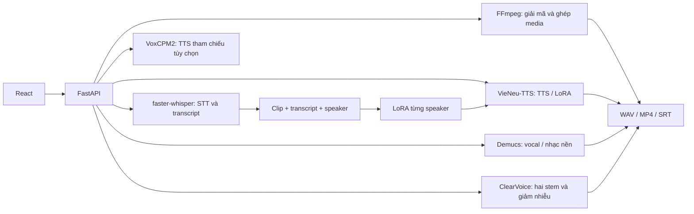

# Vocalab · AI Voice Studio

Vocalab là ứng dụng React + FastAPI chạy cục bộ để tạo giọng tham chiếu từ audio/video/micro, fine-tune giọng bằng LoRA, chuyển lời nói thành văn bản (STT), tổng hợp giọng từ văn bản (TTS) và lồng tiếng vào media. Dự án ưu tiên `vi-VN` và `en-US`.

**Nói đúng về dự án:** hệ thống tích hợp model đã được huấn luyện sẵn và fine-tune **adapter VieNeu-TTS theo từng speaker**. Nó **không train model nền từ đầu**, **không có RAG**, và **không bảo đảm clone giống hệt mọi file đầu vào**. [Báo cáo số liệu](TRAINING_REPORT.md) · [Catalog checkpoint](models/catalog.json) · [Tải 15 adapter đã fine-tune](https://github.com/minhnhatdepzai/voice-deeplearning/releases/tag/v0.1.0-models).

**Bắt đầu cho người đóng góp:** [Cài bằng Docker và CI/CD](docs/DEPLOYMENT.md) · [Kiến trúc và chỗ cần sửa](docs/ARCHITECTURE.md) · [Hướng dẫn gửi pull request](CONTRIBUTING.md) · [Giấy phép MIT cho mã nguồn](LICENSE). Model, dữ liệu giọng và bản ghi không thuộc giấy phép mã nguồn.

## Kiến trúc và luồng xử lý



| Trang | Việc người dùng làm | Xử lý thực tế |
| --- | --- | --- |
| Thư viện giọng | Tải MP3/MP4/WAV tối đa 60 phút, ghi micro, nghe/xóa file, fine-tune | Có thể tự tìm cụm giọng nói nhiều nhất; giữ file gốc đầy đủ; nghe/sửa/bỏ clip Whisper trước khi train |
| Studio | Chọn giọng và locale, viết thoại, điều chỉnh nhịp/giọng, chèn vào media | VieNeu/VoxCPM2 tạo WAV; FFmpeg chỉnh và xuất WAV/MP4 |
| Speech to speech | Thu liên tục, bấm **Dừng & nghe**, rồi nghe toàn đoạn bằng giọng đã train | MediaRecorder Opus → job lưu trên đĩa → Whisper turbo → chia text dài → VieNeu worker giữ nóng → ghép/lọc WAV; tải lại trang vẫn xem được tiến độ |
| Chuyển lời nói | Tải audio/video, lấy TXT/SRT | faster-whisper nhận dạng và gắn mốc thời gian |
| Tách theo người | Tự tìm người nói nhiều nhất hoặc chọn giọng mẫu, rồi giữ/bỏ người đó | Whisper tìm lời, encoder phân cụm/chọn người; MossFormer2 tách hai stem; FRCRN giảm nhiễu; xuất WAV/MP4 |
| Tự luyện giọng | Đọc câu gợi ý vào micro, xác nhận bản ghi | Chuẩn hóa/kiểm tra clip, chia tập và xếp hàng LoRA |
| Huấn luyện AI | Chọn dataset/speaker, prepare, train, evaluate, register | Gọi recipe LoRA VieNeu và đánh giá |
| Chỉnh sửa media | Cắt/tách/đổi thứ tự clip, tắt âm gốc, chèn WAV AI | Timeline cơ bản + FFmpeg, chưa có đầy đủ hiệu ứng/keyframe như CapCut |

Video giữ hình gốc và phối âm thanh theo lựa chọn: giữ tiếng gốc, tắt tiếng gốc, hạ tiếng khi AI nói, hoặc tách vocal để giữ nhạc nền. Demucs `htdemucs` tách **vocal chung** khỏi nhạc nền. Công cụ **Giữ hoặc loại bỏ giọng của một người** dùng [ClearVoice MossFormer2_SS_16K](https://github.com/modelscope/ClearerVoice-Studio/blob/main/clearvoice/README.md) tách tối đa hai stem, encoder speaker VieNeu đối chiếu với mẫu 3–8 giây, và tùy chọn FRCRN_SE_16K để giảm nhiễu. Nó xuất WAV giọng mục tiêu, WAV phần còn lại và MP4 nếu đầu vào là video. Đây là nhận diện theo mẫu giọng rồi tách âm, không phải nhận diện danh tính pháp lý.

## Cài đặt

Cần Linux, Python 3.10–3.13, Node.js 20+, `ffmpeg`, `ffprobe` và GPU NVIDIA CUDA cho VieNeu TTS/fine-tune. `ffmpeg -filters` cần có `rubberband` nếu muốn chỉnh pitch và tempo. Có internet lần đầu để tải model. Dự án đã chạy trên RTX 5060 Ti 16 GiB; GPU khác chưa có số đo capacity tương ứng.

```bash
git clone https://github.com/minhnhatdepzai/voice-deeplearning.git
cd voice-deeplearning
./run.sh
```

`run.sh` tạo `.venv`, cài Python/npm, build React và mở **http://127.0.0.1:8000**. Phát triển UI: `npm run dev`, mở http://127.0.0.1:5173. Muốn fine-tune hoặc cài adapter trên Release:

```bash
bash training/setup.sh
```

Script clone [VieNeu-TTS](https://github.com/pnnbao97/VieNeu-TTS) vào `data/upstream/vieneu`, pin commit `04044e1b8f822f946bafb2c88b716459f4164152` ngày 19/10/2026, cài extra `finetune`. Commit này dùng clip 3–15 giây cho recipe LoRA. `data/`, `.venv/`, `node_modules/`, `kaggle.json` không vào Git. Ứng dụng được thiết kế cho một người dùng trên máy cá nhân; API **chưa có xác thực để mở trực tiếp ra Internet**.

Để dùng tách giọng theo người nói và lọc trước khi fine-tune, cài ClearVoice trong môi trường riêng (checkpoint tự tải ở lần đầu, cần khoảng 1 GB dung lượng model):

```bash
bash training/setup_voice_filter.sh
```

Ở trang Studio, tải audio/video cần xử lý và chọn một trong ba cách: tự tìm cụm giọng có tổng thời lượng lớn nhất, chọn giọng trong thư viện, hoặc tải mẫu 3–8 giây chỉ có đúng người đó. Chọn giữ/bỏ rồi nghe hai WAV đầu ra. Với video, lựa chọn giữ/bỏ quyết định track tiếng trong MP4. Tối đa 60 phút mỗi lượt. Tỷ lệ cụm là ước tính trên phần lời nói nhận diện được, không xác minh danh tính thật. Những đoạn không đạt ngưỡng khớp giọng sẽ im trong WAV mục tiêu và vẫn nằm trong WAV còn lại. Model hai stem chạy ở 16 kHz nên bản sau lọc không còn dải tần cao của bản gốc; bản thu micro sạch ở 24 kHz trở lên vẫn là nguồn tốt hơn cho TTS. Model không bảo đảm xử lý đúng khi có trên hai người nói chồng nhau, giọng gần giống, nhạc lớn hoặc mẫu tham chiếu bẩn. Bản bỏ giọng là phần dư của bản gốc sau khi trừ stem ước lượng nên có thể còn vết giọng. Hãy nghe và kiểm tra trước khi dùng để train hoặc xuất bản.

### Cách dùng nhanh

1. Trong **Thư viện giọng**, tải bản thu tối đa 60 phút mà bạn được phép sử dụng. Với phỏng vấn nhiều người, chọn **Tự tìm người có tổng thời lượng nói nhiều nhất**; với mẫu sạch, có thể tự chọn điểm bắt đầu cho đoạn 3–8 giây.
2. Nghe mẫu trên thẻ giọng. Có thể **Thêm bản thu sạch cùng người nói** nhiều lần; các file trùng nội dung bị từ chối. Bấm **Lọc và fine-tune lại từ tất cả bản thu** khi đủ dữ liệu. Worker lọc từng file theo mẫu rồi phiên âm. Khi đủ 5 phút và 50 đoạn, thẻ giọng hiển thị các clip để nghe, sửa lời hoặc bỏ đoạn lẫn người/nhiễu; bấm **Đã duyệt clip · bắt đầu train** mới cho LoRA chạy. Nếu sau lọc hoặc sau duyệt còn quá ít dữ liệu, adapter cũ vẫn được giữ.
3. Trong **Studio**, chọn `Tiếng Việt tự nhiên` hoặc `English · General American`, nhập thoại, chọn VieNeu/VoxCPM2 và xuất WAV/MP4.
4. Trong **Speech to speech**, chọn giọng đã train rồi bấm **Bắt đầu thu**. Nói liên tục và nghỉ tùy ý; ứng dụng không tự chốt theo khoảng im lặng. Khi nói xong, bấm **Dừng & nghe** để gửi một job xử lý và phát lại. Job lưu tiến độ trên đĩa và tiếp tục sau khi tải lại trang hoặc khởi động lại API nếu file đầu vào còn đó. Không có giới hạn số giây cố định; tải lên vẫn giới hạn 500 MB và trình duyệt giữ bản ghi trong bộ nhớ tới lúc bấm dừng. Đeo tai nghe để tránh micro thu lại loa.
5. Trong **Chuyển lời nói**, tải audio/video để lấy TXT/SRT. Trong **Chỉnh sửa media**, thêm clip và WAV AI để xuất bản phối mới.

## Model và vai trò

| Thành phần | Công nghệ | Tác dụng | Đã fine-tune trong dự án? |
| --- | --- | --- | --- |
| TTS chính | [VieNeu-TTS v3 Turbo](https://huggingface.co/pnnbao-ump/VieNeu-TTS-v3-Turbo) | Sinh giọng Việt/Anh bằng text và mẫu speaker | **Có**, LoRA theo speaker |
| TTS tham chiếu | [VoxCPM2](https://github.com/OpenBMB/VoxCPM) | Clone tức thì từ WAV tham chiếu | **Không**, chỉ inference |
| STT | [faster-whisper `small` / `turbo`](https://github.com/SYSTRAN/faster-whisper) | `small` cho file/baseline cũ; `turbo` giữ nóng cho speech to speech | **Không**, pretrained; có thể đổi `WHISPER_MODEL` |
| Tách âm | [Demucs `htdemucs`](https://github.com/facebookresearch/demucs) | Vocal và nhạc nền | **Không** |
| Tách người/giảm nhiễu | [ClearVoice MossFormer2_SS_16K và FRCRN_SE_16K](https://github.com/modelscope/ClearerVoice-Studio/blob/main/clearvoice/README.md) | Hai stem lời nói và giảm nhiễu | **Không**; pretrained |
| Speaker embedding | Encoder của VieNeu | Đặc trưng âm sắc, chọn mẫu/preset, cosine | **Không**, encoder đóng băng |
| Media/prosody | FFmpeg + `rubberband` | Cắt/ghép, pitch, tempo, âm lượng, xuất file | Không phải model học máy |

VieNeu base model từ Hugging Face được tải khi cần, không chứa trong repo. LoRA lưu cập nhật nhỏ cho model đó; adapter riêng **không chạy được nếu thiếu base**. VoxCPM2 không đọc adapter VieNeu. Chọn `en-US`/`vi-VN` giúp chọn giọng và chuẩn hóa text; nó không thể tự biến giọng vùng khác thành giọng bản ngữ.

### Có RAG không? RAG gì?

**Không có RAG.** RAG cần kho tài liệu, bước truy hồi theo truy vấn và đưa tài liệu tìm được vào model sinh. Dự án không có vector database, document chunking, retriever hay augmented prompt. `speaker_embedding` là vector biểu diễn âm sắc để điều kiện hóa giọng và tính tương đồng; đó **không phải** embedding tài liệu hay vector search. Transcript từ Whisper dùng cho STT/nhãn train, không phải knowledge base.

## Fine-tuning: dữ liệu, thuật toán và kiểm chứng

1. **Thu thập:** chọn từng speaker riêng từ VIVOS/LibriTTS/LJ Speech/EmoV, hoặc lấy file người dùng. Corpus công khai có audio-text ghép cặp; file người dùng được faster-whisper tạo transcript tự động.
2. **Tiền xử lý:** FFmpeg chuyển về WAV mono 24 kHz. `training/pipeline.py` lọc clip ngoài 3–15 giây, clip không phù hợp/trùng và chia train/validation/test theo câu. `training/uploaded_audio.py` đọc file dài từng khúc 300 giây có chồng biên, lấy word timestamps, cắt thành các câu ngắn vừa giới hạn recipe. Mỗi file tải qua giao diện dài tối đa 60 phút; im lặng/nhạc hoặc lời ASR bỏ sót không tạo mẫu train.
3. **Mã hóa:** `training/run.py` gọi `finetune/prepare_dataset.py` của VieNeu để tạo Parquet text + mã audio. ONNX codec/speaker encoder upstream vẫn dùng CPU ở bước này; optimizer LoRA chạy CUDA. GPU cao không đồng nghĩa mọi bước đều chạy GPU.
4. **LoRA:** gọi `finetune/train_lora.py` upstream, học cập nhật hạng thấp trên backbone hoặc cả acoustic decoder (`target=all`), giữ phần lớn base cố định. Về mặt toán học, cập nhật một ma trận gần đúng `ΔW = (alpha/r) · B A`. Các run đầu thường `rank=16`, `target=backbone`, batch 2; run dài thường `rank=32`, `target=all`, batch 14, gradient accumulation 2. **Cấu hình và số optimizer updates chính xác của từng run nằm trong [catalog](models/catalog.json)**, không phải tất cả chạy một cấu hình.
5. **Checkpoint:** lưu `adapter_model.safetensors`, config/tokenizer, merge với base, tạo preset speaker. Script nạp lại adapter trong tiến trình mới và so SHA-256 model merge. Catalog chỉ lấy run `evaluated` đã cold-reload thành công.
6. **Đánh giá:** với corpus công khai, sinh WAV từ test chưa train, dùng Whisper đo WER/CER trên cả WAV gốc và WAV AI; encoder speaker tính cosine với mẫu enroll. Đây là chỉ số **proxy**, không thay bài nghe người thật về tự nhiên, accent, ngữ điệu và mức giống người nói.

**File upload và giới hạn 8 giây:** VieNeu clone tức thì dùng tối đa khoảng 8 giây tham chiếu theo code upstream. File nguồn tối đa 60 phút và pipeline **fine-tune** đọc từ đầu đến cuối. Chế độ tự động dùng Whisper tìm đoạn lời nói, VieNeu speaker embedding phân cụm và chọn cụm có tổng thời lượng lớn nhất để lấy mẫu tham chiếu. Khi train từ giao diện, worker lọc theo mẫu đó trước ASR và LoRA; đoạn không khớp giọng không đưa vào dữ liệu train. Nếu sau lọc còn dưới 5 phút hoặc 50 đoạn, trạng thái là `needs_more_data` và adapter hiện có không bị thay. Với dữ liệu đủ, bản train thử dùng ít nhất 5 câu test tách riêng; nếu WER AI cao hơn WAV gốc quá 20 điểm phần trăm, trạng thái là `needs_review` và worker dừng trước khi thay adapter. API cũ `/train-full` không có `?clean=true` vẫn chạy pipeline gốc. **Model cuối được train lại trên toàn bộ clip nhận diện được, không giữ test split riêng**. Không được trình bày WER precheck như WER held-out của model cuối. File dài chỉ giúp khi có nhiều lời sạch, đúng một người nói và transcript chính xác. Việc tách/lọc tự động có thể làm mất âm tiết hoặc nhận nhầm người; hãy nghe mẫu, sửa transcript và thu thêm lời sạch trước khi xem adapter mới tốt hơn.

**Độ tự nhiên của TTS:** chế độ `Tự nhiên` giữ nguyên PCM do model sinh nếu pitch/tempo/gain ở mặc định, tránh thêm biến dạng từ `rubberband`. Các phong cách có chỉnh nhịp/cao độ vẫn qua FFmpeg. Bản ghi nhiều tiếng ù/đường phố, chỉ 2–3 phút lời nói hoặc nhãn ASR sai không thể khắc phục chỉ bằng tăng số bước LoRA; nên ưu tiên thu thêm 10–30 phút một người, phòng yên tĩnh, mic ổn định, nghe và sửa nhãn. Chưa có MOS/ABX hoặc phép thử đủ mạnh để tuyên bố một giọng fine-tune cụ thể đã đạt chất lượng người thật.

**Diễn cảm MC/thuyết trình/kể chuyện:** preset và điều khiển từng dòng áp dụng pitch, tempo, âm lượng, nhấn/ngắt nghỉ, lên/xuống giọng cuối câu **sau khi TTS sinh audio** bằng FFmpeg `rubberband`. Chúng không phải style token hoặc model cảm xúc đã train riêng. Tiếng Việt chuẩn và Anh Mỹ phụ thuộc giọng mẫu, dữ liệu và text; chọn locale không bảo đảm accent.

## Dataset, giấy phép và nguồn huấn luyện

| Dataset | Ngôn ngữ | Vai trò | Quyền sử dụng nguồn |
| --- | --- | --- | --- |
| [VIVOS Zenodo](https://zenodo.org/records/7068130), [Kaggle mirror](https://www.kaggle.com/datasets/kynthesis/vivos-vietnamese-speech-corpus-for-asr) | Việt | LoRA theo speaker, test | Bản gốc CC BY-NC-SA 4.0, nghiên cứu phi thương mại; metadata mirror khác, áp điều kiện bản gốc |
| [LibriTTS dev-clean](https://www.openslr.org/60/) | Anh | LoRA theo speaker, test | CC BY 4.0, cần ghi công |
| [LJ Speech 1.1](https://keithito.com/LJ-Speech-Dataset/) | Anh | LoRA speaker LJ, run dài | Public domain tại Mỹ; kiểm tra quy định nơi sử dụng |
| [EmoV-DB](https://github.com/numediart/EmoV-DB) | Anh | LoRA Jenie · Amused | [Nghiên cứu/giảng dạy/thử nghiệm cá nhân phi thương mại](https://github.com/numediart/EmoV-DB/blob/master/LICENSE.md) |
| [FPT Open Speech](https://data.mendeley.com/datasets/k9sxg2twv4/4), [Kaggle mirror](https://www.kaggle.com/datasets/thinh127/fpt-open-speech-dataset-fosd-vietnamese) | Việt | **Chỉ benchmark STT** | Mirror thiếu speaker ID tin cậy; không dùng fine-tune TTS |

`training/sources.json` lưu URL và điều kiện nguồn. VIVOS, LibriTTS và các speaker khác được train thành **adapter riêng**, không gộp người nói. Cần xem giấy phép riêng của dataset và base model; checkpoint công khai **không cấp thêm quyền thương mại hoặc mạo danh người nói**.

Ví dụ tải và train một speaker Việt:

```bash
# Đặt kaggle.json cá nhân trong thư mục dự án; file đã bị gitignore.
uv pip install --python .venv/bin/python kaggle
mkdir -p data/datasets/vivos
KAGGLE_CONFIG_DIR="$PWD" .venv/bin/kaggle datasets download -d kynthesis/vivos-vietnamese-speech-corpus-for-asr -p data/datasets/vivos
python3 training/pipeline.py speakers --source vivos --archive data/datasets/vivos/vivos-vietnamese-speech-corpus-for-asr.zip
python3 training/pipeline.py prepare --source vivos --archive data/datasets/vivos/vivos-vietnamese-speech-corpus-for-asr.zip --speaker VIVOSSPK13 --output data/prepared/vivos_VIVOSSPK13 --max-clips 300
.venv/bin/python -m training.run --dataset data/prepared/vivos_VIVOSSPK13 --steps 90 --run my_vivos_spk13
.venv/bin/python -m training.evaluate --run-dir data/training_runs/my_vivos_spk13 --train-python data/upstream/vieneu/.venv/bin/python --count 20
```

`training/auto_train.py`, `training/extended_train.py`, `training/self_train.py` và `training/upload_train.py` điều phối các luồng train. Worker dùng khóa GPU để tránh nhiều model nặng cùng chạy. Batch lớn có thể OOM tùy VRAM còn trống và chiều dài mẫu; kiểm tra `nvidia-smi` và trạng thái/log run trước khi kết luận GPU có hoạt động.

## Checkpoint đã fine-tune: tải và sử dụng

[Release `v0.1.0-models`](https://github.com/minhnhatdepzai/voice-deeplearning/releases/tag/v0.1.0-models) có **15 archive LoRA** từ 4 corpus công khai. Mỗi archive có `adapter/adapter_model.safetensors`, `adapter_config.json`, tokenizer, `voices_v3_turbo.json`, một WAV **do model sinh**, và `metadata.json`. [Catalog](models/catalog.json) ghi SHA-256 asset/adapter/preset, source/license, số clip/bước, WER/cosine. Checkpoint trung gian, merged base, raw dataset, file tải lên của người dùng và adapter học từ các file upload **không được công bố**.

```bash
bash training/setup.sh
.venv/bin/python scripts/install_public_model.py vivos_vi_spk17_extended_b14
.venv/bin/python scripts/install_public_model.py ljspeech_en_lj_extended_b14
```

Installer tải và so SHA-256, giải nén an toàn, merge với VieNeu base, chép preset, rồi đăng ký giọng vào Studio nếu API đang chạy. Nếu server chưa chạy, mở `./run.sh`, sau đó dùng trang **Huấn luyện AI** hoặc gửi `POST /api/training/register` với JSON `{"run":"vivos_vi_spk17_extended_b14"}`. Có thể dùng asset đã tải qua `--asset /duong/dan/run.tar.gz`. LoRA **không** là model độc lập; cần base VieNeu và môi trường CUDA để merge/inference.

## Kết quả kiểm thử và cách đọc số liệu

[TRAINING_REPORT.md](TRAINING_REPORT.md), [benchmark phỏng vấn tiếng Anh](docs/ENGLISH_INTERVIEW_BENCHMARK_2026-10-22.md) và [models/catalog.json](models/catalog.json) lưu kết quả từng giọng. Bảy run đầu có 1.603 clip train (~97,8 phút) và validation/test riêng. Ví dụ VIVOSSPK15: trên 19 câu test, WER khi Whisper đọc WAV gốc **13,6%**, WAV AI **11,7%**; cosine gốc với mẫu enroll **0,735**, AI với mẫu enroll **0,741**. Đây là một tập test của một speaker, không phải cam kết chất lượng mọi giọng. Các run mở rộng có số liệu riêng trong catalog.

Benchmark STT độc lập FPT Open Speech: faster-whisper `small` trên 60 câu Việt có WER **35,3%** (Set001 **29,5%**, Set002 **40,1%**). Whisper chưa được fine-tune. WER của TTS chịu cả lỗi tổng hợp âm lẫn lỗi ASR; cosine không chứng minh danh tính hay độ tự nhiên. Không so trực tiếp WER giữa hai speaker có câu test khác nhau để xếp hạng chất lượng.

Benchmark tương tác ngày 22/10/2026 dùng 19 câu test VIVOSSPK15 chưa dùng trong các adapter upload: `small` beam 1 đạt WER **13,58%** trong 2,24 giây tổng inference; `turbo` beam 3 đạt **4,32%** trong 3,74 giây, còn beam 5 có cùng WER nhưng chậm hơn. Vì vậy trang Speech to speech mặc định `turbo` beam 3 và giữ model trong VRAM. Với giọng upload `abc · Fine-tune toàn file`, 19 lượt HTTP đầy đủ sau warmup có WER đầu vào **4,94%**, WER đọc lại đầu ra **9,26%**, cosine giọng trung bình **0,527** và thời gian xử lý trung bình **0,55 giây/lượt**. Các số latency này đo trên câu ngắn; chế độ hiện tại bắt đầu xử lý khi người dùng chủ động bấm dừng. Lọc nhẹ FFmpeg giảm noise-floor proxy từ **−59,24** xuống **−61,39 dBFS**, WER không xấu đi trong phép thử. Đây vẫn không phải MOS/ABX hay bằng chứng giọng giống người thật.

## Hỏi đáp khi phỏng vấn

**Bạn đã tự huấn luyện gì?** LoRA của VieNeu-TTS v3 Turbo theo từng speaker. Tôi không huấn luyện từ đầu VieNeu, VoxCPM2, Whisper hoặc Demucs. Adapter `.safetensors` và cấu hình/số bước từng run có trong Release/catalog.

**Tại sao LoRA?** Nó chỉ tối ưu cập nhật hạng thấp, làm checkpoint nhỏ và giảm tham số phải học. Kết quả vẫn phụ thuộc audio sạch, một speaker nhất quán, transcript đúng và đánh giá ngoài tập train.

**Có RAG hoặc vector DB không?** Không. Speaker embedding là đặc trưng âm sắc, không phải cơ chế truy hồi tài liệu.

**File dài có bị cắt 8 giây?** Không khi fine-tune: pipeline đọc toàn bộ file tối đa 60 phút, chia các phần lời được nhận diện, model cuối dùng mọi clip đạt chuẩn. Tám giây chỉ là tham chiếu clone tức thì. Im lặng, nhạc, lời của cụm khác, hoặc lời ASR bỏ sót không trở thành dữ liệu train.

**Tại sao file giọng nữ có thể ra giọng khác?** Kiểm tra Studio chọn đúng **giọng fine-tune** và model VieNeu, trạng thái run/số clip/hash adapter, nghe mẫu WAV. File pha nhiều người, nhạc, transcript sai hoặc dữ liệu quá ít có thể làm adapter lệch. Cosine, F0 và ASR là tín hiệu kiểm tra, không chứng minh giọng giống hệt.

**Đánh giá ra sao?** Với corpus công khai, tách train/validation/test; sinh WAV test, đo WER/CER bằng ASR và cosine bằng encoder speaker; nạp lại adapter rồi so hash model merge. Model upload cuối train toàn bộ clip nên không tự nhận có test held-out.

**Giới hạn hiện tại?** Công cụ tách theo giọng tham chiếu xử lý tối đa hai stem và có thể nhầm khi giọng chồng/giống nhau; chưa có diarization tổng quát hoặc bước sửa transcript thủ công trong pipeline upload, chưa làm MOS/ABX với người nghe hoặc benchmark accent tổng quát, chưa có xác thực đa người dùng. Editor là timeline cơ bản.

## Mã nguồn và tài liệu gốc

- `src/`: React UI; `src/SpeechToSpeech.jsx` thu thủ công bằng MediaRecorder và chỉ gửi khi người dùng bấm dừng. `server/app.py`: API, thư viện giọng và job; `server/realtime_voice.py` giữ VieNeu worker nóng. `server/media_edit.py`, `server/prosody.py`: timeline/điều khiển audio.
- `training/pipeline.py`, `training/uploaded_audio.py`: chuẩn bị corpus/file dài. `training/run.py`: LoRA. `training/evaluate.py`, `training/speaker_similarity.py`: đánh giá. `training/benchmark_interactive_stt.py`, `training/benchmark_speech_to_speech.py`, `training/benchmark_postprocess.py`: benchmark tương tác. `training/synthesize.py`: inference model merge.
- `scripts/package_public_adapters.py`: đóng gói adapter công khai đã đánh giá. `scripts/install_public_model.py`: tải, kiểm checksum, merge và đăng ký.
- `data/`: dữ liệu, file người dùng, model base, checkpoint và output cục bộ; bị loại khỏi Git.

Tài liệu gốc: [VieNeu recipe LoRA](https://github.com/pnnbao97/VieNeu-TTS/blob/main/finetune/README.md), [VieNeu model card](https://huggingface.co/pnnbao-ump/VieNeu-TTS-v3-Turbo), [VoxCPM](https://github.com/OpenBMB/VoxCPM), [faster-whisper](https://github.com/SYSTRAN/faster-whisper), [Demucs](https://github.com/facebookresearch/demucs). [Khảo sát điều khiển giọng](VOICE_CONTROLS_RESEARCH.md) ghi rõ phần phong cách do hậu xử lý và giới hạn thực tế.
